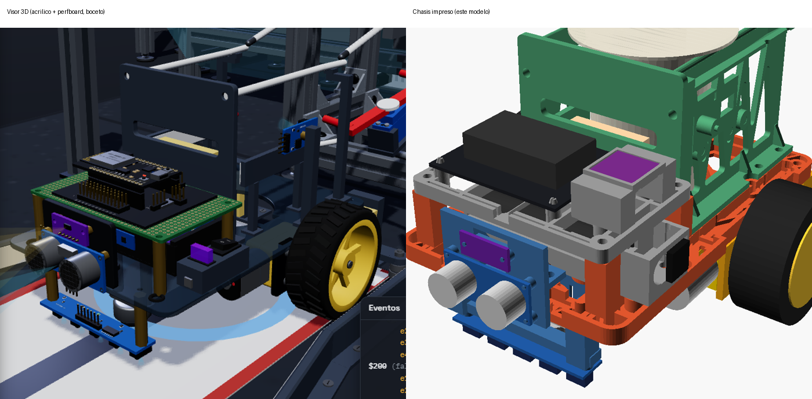
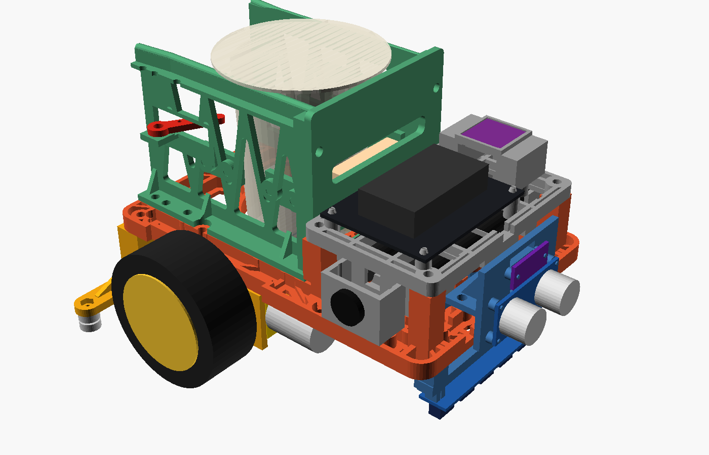
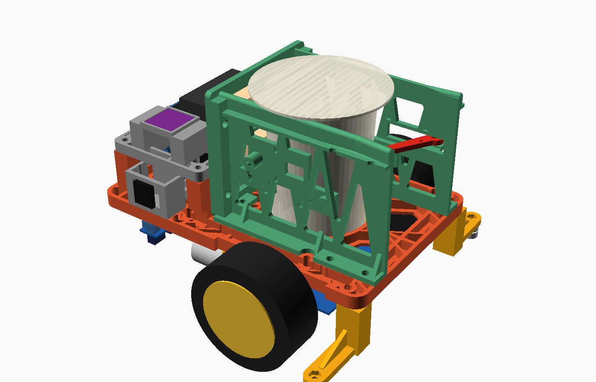
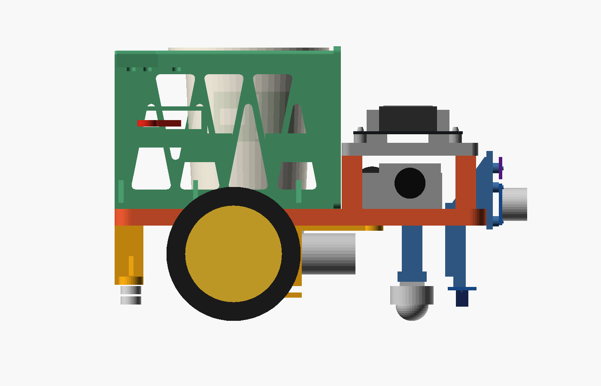
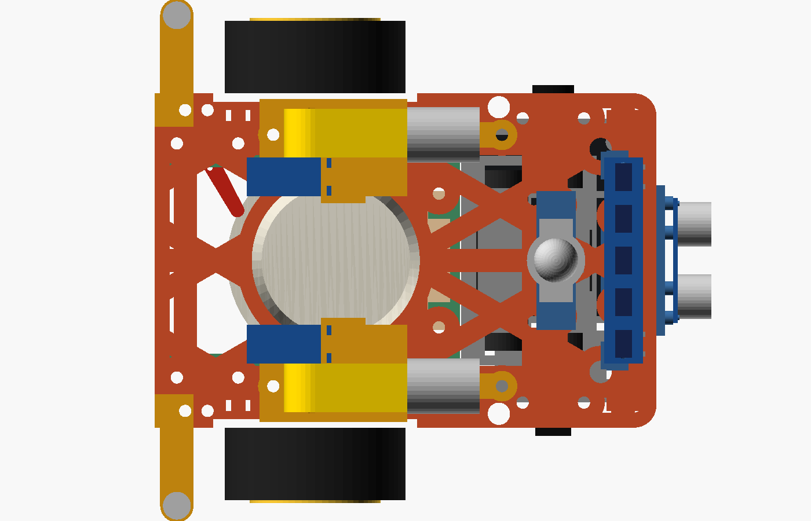
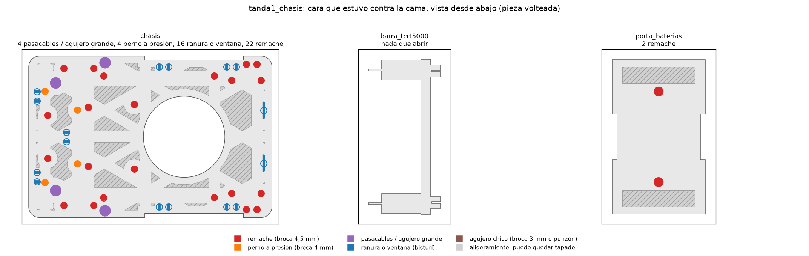
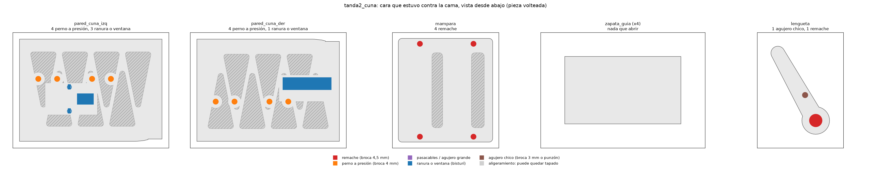
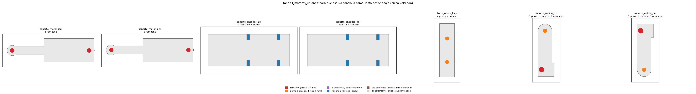
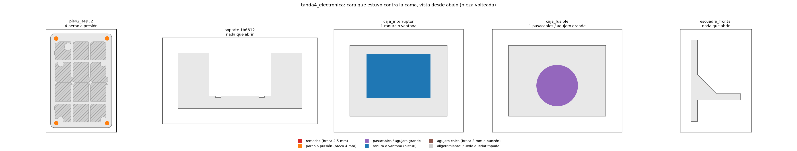
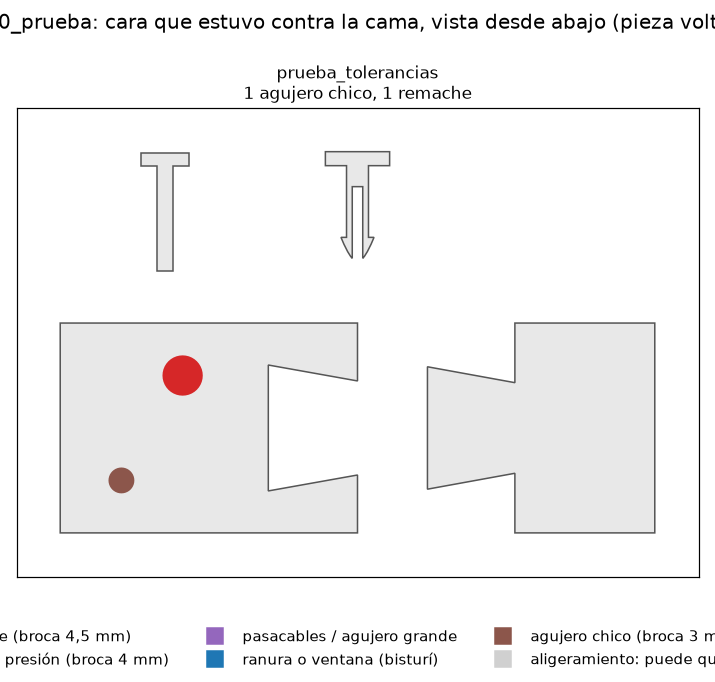

# Chasis impreso del carro

Chasis y soportes del carro de la planta de monedas, rediseñados desde cero para imprimirlos en PLA en una
Creality Hi (cama de 260 × 260 × 300 mm, boquilla de 0,4 mm). El modelo es paramétrico, en OpenSCAD. Todas las
medidas son variables al principio de [`chasis.scad`](chasis.scad), en el mismo marco que la simulación y el
visor: x adelante, y a la izquierda, z arriba, origen en el piso bajo el centro del carro.

Las piezas se unen **sin tornillos**, a presión: remaches impresos, pernos a presión, pasadores y bridas. Solo
quedan 4 tornillos M3, en los dos puntos donde hay metal comprado.



| | |
|---|---|
|  |  |
|  |  |

Colores del render: chasis en naranja, soportes de motor y rodillos en amarillo, cuna en verde, soportes de
sensores en azul y electrónica en gris. Las piezas compradas (motores, ruedas, pack, placas, vaso) solo se
dibujan para comparar.

## Cómo regenerar todo

```bash
python exportar.py
```

Este comando exporta **dos versiones** de cada pieza, ya acostada en su orientación de impresión: un STL por
pieza y un 3MF por tanda, con las piezas acomodadas en la cama.

| Carpetas | Primera capa | Después de imprimir |
|---|---|---|
| `stl_con_membrana/`, `3mf_con_membrana/` | Un solo contorno, sin saltos (para PLA húmedo) | Hay que abrir los agujeros: ver la guía de corte |
| `stl_sin_membrana/`, `3mf_sin_membrana/` | Con todos los agujeros y vaciados abiertos (más saltos) | No hay que cortar nada |

También revisa choques entre piezas y contra los componentes
comprados, y estima masa y tiempo (lo deja en `piezas.json`). Tarda menos de un minuto. Usa el OpenSCAD portátil
de `D:\cosas uni\Micros\instalados\openscad` (versión 2026.10.02, 202 MB) y numpy del Python global.

Para ver el carro completo, abre `chasis.scad` en OpenSCAD con `pieza = "ensamble"`. Para cambiar una medida,
edita la variable y vuelve a correr `exportar.py`. Si el chasis deja de caber en la cama (por ejemplo, si
cambias `L` a 280), se parte solo en `chasis_a` y `chasis_b`. Las dos mitades se unen con colas de milano
detrás del hueco del vaso y llevan debajo una plaquita (`union_corte`) con 4 remaches. Ese caso está probado
con L = 280.

## Primera capa sin saltos (PLA húmedo)

Con el PLA húmedo, cada salto de la boquilla en la primera capa deja un hilo o un puntito. El filamento se
enrolla en la boquilla y la capa se arruina, con brim o sin él. Las piezas que no tienen saltos en la primera
capa salían bien. Por eso `exportar.py` le agrega a cada pieza, ya acostada, una **membrana de
0,6 mm** que tapa sus vaciados y agujeros chicos ([`primera_capa.scad`](primera_capa.scad)). Solo queda
abierto el hueco del vaso. Así la primera capa queda de un solo contorno:

| Pieza | Contornos en la primera capa antes → ahora | Qué abrir después de imprimir |
|---|---|---|
| chasis | 85 → 2 | Agujeros de remache (broca de 4,5 mm a mano), los 4 agujeros ciegos de abajo para la torre y la barra (broca de 4 mm), 4 pasacables (broca de 8 mm), ranuras de bridas (bisturí). Los vaciados en triángulo se quedan tapados: no estorban. |
| paredes de la cuna | 19 → 1 | Agujeros de remache y de las zapatas (broca de 4 mm), ventana del TCRT5000 y de la lengüeta (bisturí), ranuras de brida. Las ventanas de la celosía pueden quedar tapadas. |
| mampara | 7 → 1 | Agujeros de remache. Las ventanas pueden quedar tapadas. |
| piso 2 | 17 → 1 | Los 4 agujeros de las columnas (broca de 4 mm) y las ranuras de bridas. Los vaciados pueden quedar tapados. |
| cajas del interruptor y del fusible | 2 → 1 | La ventana del interruptor (bisturí) y el agujero del portafusible (broca de 13 mm o bisturí). |
| porta baterías, soportes de motor, rodillos, torre, soporte TB6612 | 2-3 → 1 | Agujeros de remache, de pernos y de los tornillos de la rueda loca y de los rodillos; ranuras de la correa (porta baterías). |

La membrana mide 0,6 mm: la primera capa de 0,3 y dos de 0,15. Con solo 0,3 mm no alcanzaba, porque Creality
Print corta la capa 1 cerca de su tope, ya veía los vaciados y seguía saltando entre ellos. Con 0,6 mm la vista
previa de la capa 1 queda con solo el borde y el hueco del vaso (probado). Se rompe con la broca a mano o con
un punzón, sin taladro. Suma ~22 g
(265 g en total). **Si el filamento está seco**, pon `membrana = 0` en `primera_capa.scad`, corre `exportar.py`
y vuelven los agujeros abiertos.

**Perfiles nuevos de Creality Print** (copias de los tuyos; los originales no se tocaron):

- **Filamento "Hyper PLA @dathi 0.4 humedo".** Boquilla a 215 °C (220 °C en la primera capa) y caudal máximo
  de 18 mm³/s, para que chorree menos. Retracción de 1,2 mm, salto en Z de 0,2 mm (antes 0,4: el hilo se
  estira menos), limpieza al retraer y no retrae en movimientos de menos de 1 mm. La cama sigue a 65 °C.
- **Proceso "0.20mm Standard @dathi 0.4 sin saltos".** Brim **solo por fuera** de 3 mm: tu perfil tenía
  "outer_and_inner", que pone un brim dentro de cada agujero, y en el chasis eso eran decenas de islas en la
  primera capa. Primera capa a 40 mm/s y "evitar cruzar paredes" activado.

Aparecen al volver a abrir Creality Print. Lo que más ayuda, y estos perfiles no reemplazan, es **secar el
filamento**: 50 °C durante 6 a 8 h en un secador o en el horno con la puerta entreabierta, y guardarlo con
sílica. Antes de imprimir, limpia la boquilla en caliente con un cepillo de bronce y revisa que la funda de
silicona esté puesta.

### Guía de corte

`python guia_corte.py` dibuja, para cada tanda, la cara que estuvo contra la cama **vista desde abajo**, como se
ve al voltear la pieza. En color va lo que hay que abrir: rojo los remaches (broca de 4,5 mm), naranja los
pernos a presión (broca de 4 mm), morado los pasacables y agujeros grandes, y azul las ranuras y ventanas
(bisturí). En gris rayado van los vaciados de aligeramiento, que pueden quedar tapados. Se abre a mano: la
membrana mide 0,6 mm.

| Tanda | Guía |
|---|---|
| 1: chasis, barra, porta baterías |  |
| 2: paredes, mampara, zapatas, lengüeta |  |
| 3: soportes de motor, torre, rodillos |  |
| 4: piso 2, TB6612, cajas, escuadra |  |
| 0: pieza de prueba |  |

Los agujeros de las caras que **no** tocaron la cama (por ejemplo, los del pie de las paredes) salen abiertos y
no están en la guía.

**Si ya imprimiste la tanda 1 antes del 21/10 por la tarde**, hay dos cambios que tu pieza no tiene:

- **Porta baterías:** sus 2 agujeros de remache caían dentro de las ventanas de aligeramiento del piso, y el
  remache no tenía dónde apretar. Ya está corregido (las ventanas se corrieron hacia las puntas). Reimprímelo:
  son 14 g y unos 23 min.
- **Chasis:** el portafusible pasó a su propia caja en el costado derecho (la ventana del interruptor y el
  agujero del fusible no cabían juntos en una caja de 30 mm). Esa caja lleva 2 remaches que tu chasis no tiene.
  Pégala con pegante instantáneo, o perfora con broca de 4,5 mm a 9 mm del borde derecho y a 26 y 48 mm del
  borde delantero, igual que los de la caja del interruptor del lado izquierdo.

## Cómo se unen las piezas (sin tornillos)

Con ~0,7 kg y 0,4 m/s, el carro no necesita tornillos en cada unión. Hay cuatro tipos de unión, y todas se
calibran con la misma pieza de prueba:

| Unión | Cómo es | Dónde |
|---|---|---|
| **Remache impreso** | Vástago de 4 mm partido en dos patas, con una uña en la punta. Se empuja por el agujero de 4,4 mm: las patas se cierran, pasan y la uña traba del otro lado. Se imprime acostado, así las patas flexan a lo largo de las capas (lo fuerte del PLA). Se saca apretando las patas con un alicate. | Toda pieza contra el chasis: soportes de motor, rodillos, pies de las paredes, mampara, porta baterías, caja del interruptor, escuadra. También la mampara contra las paredes y el pivote de la lengüeta. |
| **Perno a presión** | Perno de 4 mm de la propia pieza que entra en un agujero del mismo diámetro nominal. El agujero impreso sale ~0,15 mm más chico y aprieta. | Piso 2 sobre sus 4 columnas, soporte del TB6612, zapatas en la pared, torre de la rueda loca y barra de los TCRT5000. Estas dos últimas trabajan a compresión o cuelgan ~10 g. |
| **Perno partido con uña** | Perno de 2,9 mm partido hasta abajo de su separador, para que flexe; traba la placa electrónica. | GVS del ESP32 (4) y placa de los 5 TCRT5000 (2). |
| **Pasador a presión** | Pasador impreso de 2,9 mm. Pasa libre por la mejilla interior y la caja TT, y aprieta en la mejilla exterior. | Caja reductora TT (2 por motor). |
| Pin de ubicación + brida o pegante | Pin liso en el agujero de la placa. | HC-SR04, VL53L0X, TCRT5000 de la cuna, H206 y TB6612. |

Quedan 4 tornillos M3, porque ahí hay metal comprado: el eje de los dos rodamientos 623 de cada rodillo guía (el
rodamiento necesita un eje de 3 mm redondo de verdad) y la brida de la rueda loca de bola. Si usas
`loca_tipo = "deslizador"` (un domo impreso forrado con PTFE en vez de la bola), quedan 2.

**Si una unión a presión no aguanta**, no hay que reimprimir. Todos los agujeros de remache (4,4 mm) aceptan un
tornillo M4 con tuerca, los pernos a presión se aseguran con una gota de pegante instantáneo y los pasadores de
la caja TT se pueden cambiar por M3 × 30 con tuerca (M3 × 25 sin soporte de encoder).

## Qué se cambió respecto al visor, y por qué

El visor es un boceto: placa de acrílico, piso de perfboard sobre separadores de latón, rieles de varilla doblada
y columnas de 5 × 5 mm. Copiarlo tal cual no sirve para imprimir. Estas son las diferencias:

1. **Placa nervada en vez de placa maciza.** Tiene una piel de 2 mm vaciada en triángulos y nervios de 6 mm
   arriba (isogrid). Los nervios principales siguen las líneas de carga: y = ±42/45 (pared de la cuna → motor →
   rueda), x = eje, rueda loca y rodillos. El vaso cuelga a 7 mm del eje (x = −25 contra −32,4). Los
   componentes apoyan sobre el tope plano de los nervios (`z_plano` = 54,25).
2. **La placa queda 2,25 mm más alta** que en el visor (cara de abajo a 46,25 en vez de 44). El soporte del
   motor necesita un techo de 2,5 mm entre la caja TT y la placa; en el visor el reductor quedaba a 0,25 mm de
   la placa y se sujetaba con lengüetas en ranuras del acrílico. El eje de las ruedas no cambia, porque lo fija
   el radio de la rueda. Adelante, el soporte del motor sigue con un brazo plano por encima de la lata hasta una
   oreja pasada la lata, para que el remache no toque el motor.
3. **Rieles impresos en el borde de las paredes de la cuna**, con la boca en embudo (73 → 69 mm en 20 mm) y la
   cresta a 3 mm bajo el final de la canaleta, igual que en la simulación. Se forran con cinta PTFE. Así no hace
   falta doblar varilla de acero de 4 mm: el riel se apoya en toda la pared y el vaso pesa 133 g.
4. **Paredes de la cuna en celosía** (tipo Warren) de 3 mm, impresas acostadas para que los filamentos queden en
   el plano de la carga. En el visor eran postes de 5 × 5 mm y 80 mm de alto, que en PLA se tambalean. Con la
   mampara adelante forman una caja rígida, y la cara interior de cada pared es la guía lateral.
5. **Guías a media altura como zapatas aparte** (4 pastillas a presión). El vaso es cónico y no está medido: si
   cambia, se reimprime una zapata de 2 minutos en vez de la pared.
6. **HC-SR04 invertido**, con el conector arriba, sobre la cara de la escuadra. Sus transductores siguen a la
   altura de la simulación (z = 56,5), pero el borde de abajo de la placa queda a 46,5, más bajo que la placa
   del chasis. Al derecho, el conector chocaría con el chasis; invertido, el cable sale hacia atrás por encima.
   La escuadra queda 1 a 2 cm más adelante que `xFrente` del visor: si el firmware descuenta la posición del
   sensor, ajústalo.
7. **TB6612 en el piso 2**, junto al ESP32 (en el visor iba abajo, a la derecha). Abajo no hay lugar entre el
   pack, la caja del interruptor y la escuadra. Los cables de los motores suben por los pasacables de 8 mm.
8. **Las columnas del piso 2 se imprimen con el chasis.** Suben derecho, sin soporte, con su perno a presión
   arriba. Así no hacen falta separadores de latón.
9. **El soporte del encoder H206 es una pieza aparte (`soporte_encoder_izq/der`)** que se aprieta con los mismos
   pasadores del motor, en vez de una columna de 5 mm que baja de la placa. Así queda referido al mismo motor
   que el disco. Primero iba pegado al soporte del motor, pero así quedaba en el aire al imprimir. Se apaga con
   `con_encoders = false`.
10. **El porta baterías está pensado para el pack 2S soldado con BMS**, con correa de velcro. Si usas un
    portapilas de plástico con celdas sueltas (76,6 × 41 mm), cambia `pack_largo` y el ancho, o pégalo encima.

Lo demás se mantiene como en la simulación: el largo y el ancho del carro (180 × 120), el eje de las ruedas, los
rodillos guía a y = ±88, la rueda loca adelante, los 5 TCRT5000 a 7 mm del piso, el VL53L0X a 74 mm y la cuna
con el vaso colgado a z = 129. Si los cambiaras, la simulación y el muelle dejarían de coincidir.

## Medidas que no están verificadas (variables marcadas MEDIR)

Vienen de fichas o del visor. Mídelas con calibrador antes de imprimir las piezas que dependen de ellas:

| Variable | Valor | Cómo medirla | Pieza afectada |
|---|---|---|---|
| `tt_semi` (alto / 2), `tt_espesor`, `tt_largo_caja` | 11,25 / 18,8 / 33 | Caja amarilla: alto total y espesor a lo largo del eje, con las puntas del calibrador; largo desde el centro del eje hasta donde empieza la lata | Soportes de motor |
| `tt_agujeros`, `pasador_d` | (24, ±8,75) / 2,9 | Del centro del eje al centro de cada agujero pasante: mete una broca o varilla de 3 mm en cada agujero y mide entre ellas y hasta el eje. El diámetro del agujero, con la broca más gruesa que entre | Soportes de motor, pasadores |
| `tt_lata_largo` | 28 | De la cara de la caja a la punta de los bornes del motor | Brazo del soporte de motor |
| `d_rueda`, `ancho_rueda` | 65 / 26 | Diámetro con la goma puesta y ancho de la llanta | Altura de todo |
| `vaso_d`, `vaso_d_fondo`, `vaso_h` | 62 / 53,3 / 90 | Boca exterior, fondo exterior y alto del vaso real | Cuna y zapatas |
| `celda_d`, `pack_largo`, `pack_alto` | 18,6 / 70 / 19,5 | Pack 2S con BMS: diámetro de una celda con su forro, largo total con el níquel y la BMS, alto acostado | Porta baterías |
| `gvs`, `gvs_agujeros`, `pcb_perno_d` | 53 × 68 / 46 × 61 / 2,9 | Placa GVS: tamaño, distancia entre centros de los agujeros (borde a borde + un diámetro) y diámetro del agujero | Piso 2 |
| `tb` | 20,3 | Lado de la placa TB6612 | Soporte TB6612 |
| `hc`, `hc_agujeros`, `pin_d` | 45 × 20 / 41 × 16,5 / 1,9 | HC-SR04: tamaño, distancia entre centros de los 4 agujeros y su diámetro | Escuadra frontal |
| `vl`, `vl_agujeros_sep` | 25 × 10,7 / 20 | GY-530: tamaño y distancia entre sus 2 agujeros | Escuadra frontal |
| `ir_placa`, `ir_agujeros_y`, `tcrt_alto` | 14 × 74 / ±33,5 / 7,8 | Placa de 5 TCRT5000: tamaño, agujeros desde el centro y alto desde la cara de abajo de la placa hasta la cara del sensor | Barra TCRT5000 |
| `loca_alto`, `loca_agujeros` | 19 / 22 | Rueda loca apoyada en la mesa: del piso a la cara de **arriba** de su brida (con calibrador de profundidad); distancia entre agujeros | Torre de la rueda loca |
| `int_corte`, `fus_d` | 19,2 × 13,2 / 12,3 | Ventana que pide el interruptor (está en su ficha o se mide el cuerpo bajo la tapa) y rosca del portafusible | Caja del interruptor |
| `ir_cuna_dx` | 24 | Módulo TCRT5000 de la cuna: del centro del sensor al centro de su agujero | Pared izquierda |

## Pieza de prueba (imprimirla antes que todo)

Imprime `3mf_con_membrana/tanda0_prueba.3mf` (o la versión sin membrana) (unos 12 minutos y 7 g). Trae un tramo de cola de milano macho y hembra, un
remache de 8 mm de agarre con su agujero, un perno a presión de 4 mm con su agujero ciego y un pasador de la
caja TT con su agujero que aprieta.

| Qué probar | Bien | Si no |
|---|---|---|
| Cola de milano | Entra con la mano, sin juego lateral | Dura: `tol = 0.25`. Baila: `tol = 0.15` |
| Remache | Entra con el pulgar haciendo clic y no sale tirando con la mano | No entra: `rem_garra = 0.35`. Sale solo: `rem_garra = 0.55` |
| Perno a presión de 4 mm | Entra con un golpe suave (mango del destornillador) y no sale con la mano | Duro: `presion_holgura = 0.1`. Suelto: `presion_holgura = -0.1` |
| Pasador | Entra empujando fuerte y queda firme | Duro: `pasador_aprieto = 0.1`. Suelto: `pasador_aprieto = 0.2` |

Después corre otra vez `python exportar.py`. Los STL y 3MF que hay ahora se generaron con los valores por
defecto.

## Tandas, parámetros de impresión, tiempo y gramos

Material: PLA en todas las piezas, capa de 0,2 mm (0,12 mm en los remaches y pasadores), 4 capas arriba y 4
abajo. Las piezas de motor y de unión llevan más paredes; las tapas y los soportes de sensores, poco relleno.
Los remaches y pasadores van macizos, porque sus patas tienen que flexar sin romperse.

**Sin soportes, verificado:** `python revisar_voladizos.py` (y `exportar.py`, que lo corre en cada exportación)
lanza un rayo hacia abajo desde cada cara que mira a la cama con más de 50°. Si llega a la cama sin tocar la
pieza, es un voladizo que necesitaría soporte; si toca la pieza, es un puente (se permiten hasta 12 mm). Hoy
pasan todas las piezas, en las dos versiones. Antes del 21/10 no pasaban 4: el soporte del motor (por la repisa
del encoder), la escuadra frontal (pie y escuadras en el aire al imprimirla de costado) y el soporte del TB6612
(puente de 20 mm). Ninguna de las tres está en las tandas 1 y 2.

| Pieza | Cant. | Tanda | Medidas en la cama (mm) | Capa | Paredes | Relleno | Orientación | Esfuerzo | min c/u | g c/u |
|---|---|---|---|---|---|---|---|---|---|---|
| prueba_tolerancias | 1 | 0 | 68 × 44 × 14 | 0,2 | 3 | 20 % giroide | plana | solo mide encajes | 12 | 6,5 |
| chasis | 1 | 1 | 180 × 120 × 36 | 0,2 | 3 | 25 % giroide | piel abajo, nervios y columnas arriba | flexión y torsión, lleva todo | 111 | 77,4 |
| barra_tcrt5000 | 1 | 1 | 40 × 79 × 11 | 0,2 | 3 | 15 % rejilla | de costado (U acostada) | bajo | 10 | 5,4 |
| porta_baterias | 1 | 1 | 45 × 75 × 18 | 0,2 | 3 | 20 % giroide | piso abajo | medio | 21 | 12,7 |
| pared_cuna_izq | 1 | 2 | 106 × 77 × 13 | 0,2 | 3 | 20 % giroide | acostada, cara del vaso abajo | medio (cuelga el vaso) | 32 | 21,8 |
| pared_cuna_der | 1 | 2 | 106 × 77 × 15 | 0,2 | 3 | 20 % giroide | acostada, cara del vaso abajo | medio | 31 | 20,8 |
| mampara | 1 | 2 | 79 × 87 × 12 | 0,2 | 3 | 20 % giroide | cara delantera abajo | medio (amarra las paredes) | 25 | 16,6 |
| zapata_guia | 4 | 2 | 24 × 14 × 6 | 0,2 | 2 | 15 % rejilla | cara del vaso abajo, pernos arriba | bajo | 2 | 0,9 |
| lengueta | 1 | 2 | 21 × 32 × 3 | 0,2 | 4 | 40 % giroide | plana | bajo, gira en un remache | 2 | 0,8 |
| soporte_motor_izq / der | 2 | 3 | 93 × 25 × 29 | 0,2 | **5** | **50 % giroide** | techo abajo, mejillas arriba | alto: par del motor | 18 | 9,0 |
| soporte_encoder_izq / der | 2 | 3 | 53 × 21 × 32 | 0,2 | 4 | 40 % giroide | repisa abajo, pestaña arriba | bajo (sostiene el H206) | 13 | 4,6 |
| torre_rueda_loca | 1 | 3 | 14 × 50 × 34 | 0,2 | **5** | **50 % giroide** | brida abajo | alto (~40 % del peso) | 20 | 9,9 |
| soporte_rodillo_izq / der | 2 | 3 | 14 × 46 × 29 | 0,2 | **5** | **50 % giroide** | brazo abajo | alto (empuje del muelle) | 15 | 6,5 |
| piso2_esp32 | 1 | 4 | 67 × 102 × 14 | 0,2 | 3 | 15 % rejilla | placa abajo | bajo | 26 | 17,2 |
| soporte_tb6612 | 1 | 4 | 40 × 18 × 24 | 0,2 | 2 | 15 % rejilla | de costado (patas y marco suben derecho) | bajo | 11 | 4,7 |
| caja_interruptor | 1 | 4 | 30 × 22 × 16 | 0,2 | 2 | 15 % rejilla | panel abajo | bajo | 8 | 3,2 |
| caja_fusible | 1 | 4 | 30 × 22 × 16 | 0,2 | 2 | 15 % rejilla | panel abajo | bajo | 8 | 3,2 |
| escuadra_frontal | 1 | 4 | 28 × 38 × 50 | 0,2 | 3 | 15 % rejilla | de costado | bajo | 21 | 7,7 |
| pasador_tt | 4 | 5 | 6 × 27 × 2,4 | 0,12 | 4 | macizo | acostado sobre su cara plana | alto: sujeta la caja TT | — | 0,2 |
| remache_6 / 9_5 / 10_5 / 11 / 14 / 37 | 1 / 4 / 8 / 8 / 2 / 4 | 5 | 8 × (11 a 41) × 3,2 | 0,12 | 4 | macizo | acostado sobre su cara plana | une las piezas | — | 0,1 a 0,5 |

| Tanda (3MF) | Contenido | Tiempo aprox. | Gramos aprox. |
|---|---|---|---|
| `tanda0_prueba` | pieza de prueba | 12 min | 7 g |
| `tanda1_chasis` | chasis, barra TCRT5000, porta baterías | 2 h 20 min | 95 g |
| `tanda2_cuna` | 2 paredes, mampara, 4 zapatas, lengüeta | 1 h 40 min | 64 g |
| `tanda3_motores_uniones` | 2 soportes de motor, 2 soportes de encoder, torre de la rueda loca, 2 rodillos | 1 h 55 min | 49 g |
| `tanda4_electronica` | piso 2, soporte TB6612, cajas del interruptor y del fusible, escuadra | 1 h 15 min | 36 g |
| `tanda5_remaches_pasadores` | 27 remaches y 4 pasadores | ~25 min | 7 g |
| **Total** | 23 piezas + 29 uniones | **≈ 7,7 h** (con la membrana; el perfil @dathi a 0,15 mm tarda más) | **≈ 265 g** |

Cada tanda junta piezas con los mismos parámetros, así que se ajusta una vez por tanda. Si quieres mezclarlas,
Creality Print permite paredes y relleno por objeto, y cada pieza del 3MF es un objeto con nombre. Al abrir un
3MF, Creality Print puede preguntar si cargarlo como proyecto o solo la geometría: elige geometría y usa tu
perfil de PLA del Hi con boquilla de 0,4. Imprime dos o tres remaches de más de cada medida: son de 1 minuto y
alguno se rompe al probar.

**Masa estimada.** El chasis (placa con nervios y columnas) pesa unos **77 g**; todas las piezas impresas,
**≈ 265 g** con la membrana de la primera capa (243 g sin ella). Sumando motores con ruedas (~110 g), el pack 2S con BMS (~100 g), la electrónica y los sensores
(~60 g) y la rueda loca (~15 g), el carro queda en **≈ 0,53 kg** vacío y en ≈ 0,66 kg con el vaso lleno.
Coincide con `vehiculo.masa_kg: 0.60` de `config/parametros.yaml` (provisional).

Los tiempos y gramos son una estimación propia: volumen de la malla, cáscara según las paredes, relleno y un
caudal medio de 10 mm³/s más 2,5 s por capa. Pueden variar ±30 %. El número bueno lo da Creality Print al
laminar.

## Lo que hay que comprar (además de lo impreso)

La lista completa del carro (piezas impresas con gramos y tiempo, electrónica con precio, cables por calibre y esta ferretería) está en [lista_materiales.md](lista_materiales.md) y al comienzo del manual; se regenera con `python materiales.py`.

| Ítem | Cant. | Dónde |
|---|---|---|
| Tornillo M3 × 20 + tuerca M3 | 2 | ejes de los rodillos guía |
| Tornillo M3 × 10 + tuerca M3 | 2 | rueda loca de bola (0 si `loca_tipo = "deslizador"`) |
| Arandela M3 | 6 | entre los rodamientos y el brazo de los rodillos |
| Rodamiento 623ZZ (3 × 10 × 4) | 4 | rodillos guía (2 por lado) |
| Rueda loca de bola con brida de 2 agujeros | 1 | o el deslizador impreso |
| Bridas de 2,5 mm | ~15 | cables, TB6612, H206 y TCRT5000 de la cuna |
| Cinta PTFE de 10 a 12 mm | ~40 cm | rieles y zapatas (también sirve para el deslizador) |
| Espuma de 10 mm | 2 trozos | en la mampara (arriba y a media altura) |
| Correa de velcro de 20 mm | 1 | pack 2S |
| Elástico pequeño | 1 | lengüeta |
| Pegante instantáneo | 1 | por si un perno a presión queda flojo |
| Pasacables de goma de 8 mm (opcional) | 4 | agujeros de cables |

Antes eran 62 tornillos con sus tuercas; ahora son 4.

## Orden de ensamble

El manual ilustrado está en [`manual_armado.pdf`](manual_armado.pdf), **ordenado por tandas de impresión**
(1, 5, 2, 3, 4: los remaches de la tanda 5 se necesitan desde el primer armado). Para cada tanda trae dónde va
cada pieza, resaltada sobre el carro; qué abrir si se imprimió con membrana; y los pasos de armado que esa tanda
permite. Se regenera con `python guia_corte.py` y después `python manual.py`.

**Modelo 3D del carro armado:** [`carro_armado.glb`](carro_armado.glb) se abre con el Visor 3D de Windows,
Blender o Creality Print (cada pieza es un objeto con su nombre). [`visor_carro.html`](visor_carro.html) lo
muestra en el navegador: filtro por tanda, tocar una pieza para ver qué es y dónde va, despiezar y vistas
rápidas. Se regeneran con `python modelo_3d.py`.

El resumen de abajo sigue el orden del diseño, no el de las tandas:

1. **Motores.** Suelda los cables de los motores. Mete cada caja TT entre las mejillas de su soporte, pon el
   soporte del encoder contra la cara de adentro de la mejilla interior y empuja los 2 pasadores a través de su
   pestaña, la mejilla y la caja, hasta que asomen al ras de la exterior; el último tramo aprieta. Encaja el soporte bajo el chasis con 2 remaches desde abajo: el de 14 atrás y uno de 10,5
   adelante.
2. **Encoders.** Disco de 20 ranuras en la punta interior del eje, y el H206 sobre la repisa del soporte del
   encoder, con el disco en la horquilla y amarrado con dos bridas por las ranuras de los costados.
3. **Rueda loca, barra y rodillos.** Atornilla la rueda loca a su torre (2 × M3 × 10) y clava la torre en el
   chasis por sus dos pernos. Clava la placa de los TCRT5000 en la barra y la barra en el chasis; la cara de los
   sensores tiene que quedar a 7 mm del piso, y se calza con una arandela o un cartón entre columna y chasis.
   Para cada rodillo, pon dos 623 con arandelas en un M3 × 20 con tuerca y fija el bloque con 2 remaches de 37
   desde abajo.
4. **Ruedas.**
5. **Cuna.** Forra con PTFE el borde de arriba de las paredes (el riel) y la cara de las zapatas. Clava las
   zapatas en las paredes, pon la lengüeta con su remache de 6 y su elástico, y el TCRT5000 de la cuna en la
   pared izquierda (pin y brida). Encaja las paredes en el chasis (2 remaches de 11 cada una), después la mampara
   a las dos paredes (4 remaches de 9,5, desde adelante) y al chasis (2 remaches de 11). Al final, pega las
   espumas en la mampara.
6. **Energía.** Porta baterías (2 remaches de 10,5 por el divisor), pack con su velcro, la caja del
   interruptor a la izquierda y la del portafusible de 3 A a la derecha (2 remaches de 10,5 cada una). El cableado es B+ → fusible →
   interruptor → VM del TB6612 y VIN de la GVS; los cables pasan por los canales de los nervios.
7. **Sensores del frente.** Escuadra (2 remaches de 11). Clava el HC-SR04 **invertido** (conector arriba) en sus
   4 pines y el VL53L0X encima en sus 2. Si quedan flojos, una gota de pegante en un pin.
8. **Piso 2.** Pasa los cables de abajo por los pasacables de 8 mm y clava el piso en las 4 columnas. Encaja la
   GVS con el ESP32 en sus 4 pernos partidos (clic). Clava el soporte del TB6612 en sus 2 pernos y amarra la
   placa con una brida.
9. **Revisión antes de encender.** Que las ruedas giren libres (≥ 2 mm del soporte), que el vaso entre desde
   atrás deslizando por los rieles hasta la espuma y la lengüeta caiga detrás, y que los TCRT5000 lean la línea
   a 7 mm.

Para desarmar, aprieta las patas del remache con un alicate de punta del lado de la uña y empújalo.

## Qué falta y qué no está verificado

- Nada de esto está impreso todavía. La pieza de prueba dice si los encajes sirven con tu Hi.
- Lo que más se juega en las uniones a presión son los pernos partidos de la GVS y de los TCRT5000 (2,9 mm,
  impresos de pie) y los pasadores de la caja TT. Si fallan, el plan B está arriba.
- Faltan las medidas MEDIR de la tabla de arriba, sobre todo los agujeros de la caja TT, las placas de los
  sensores y la altura de la rueda loca.
- Los tiempos y gramos no salen del laminador: lamina los 3MF en Creality Print para tener los reales.
- La lengüeta es un trinquete simple con elástico; en el visor tenía un resorte de torsión. Hay que probarla con
  un vaso real.
