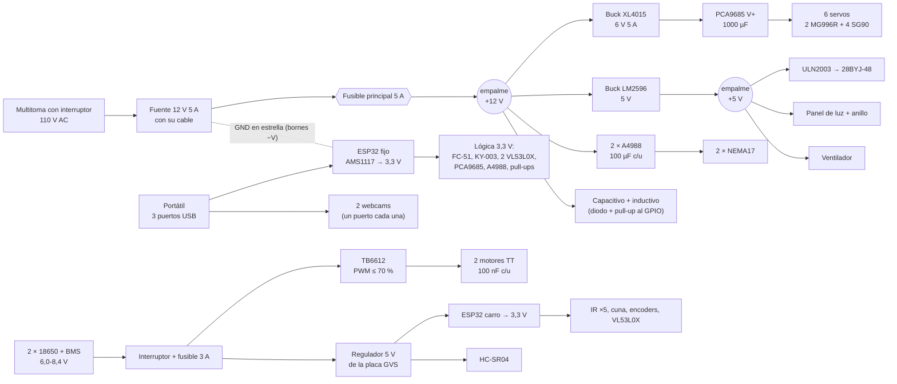
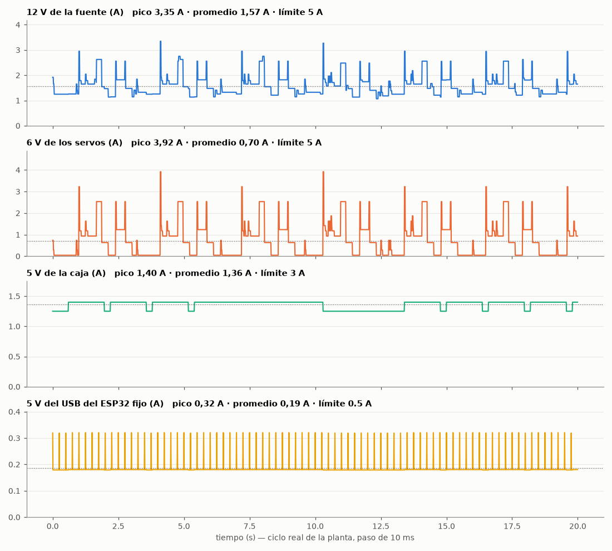
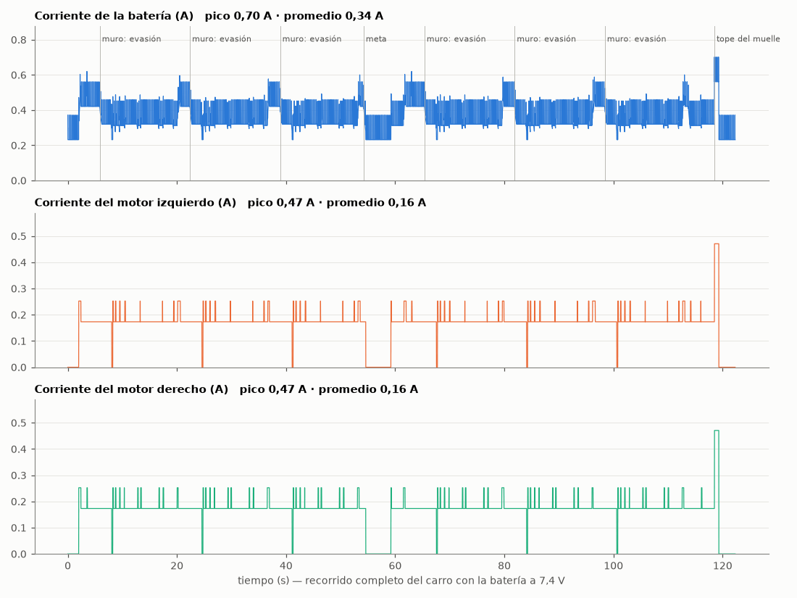

# Parte eléctrica, punto por punto (simulada)

> Generado por `python -m sim.electrica` desde `sim/electrica.py`, que lee el conexionado de `sim/conexiones.py` (la fuente única de cada hilo) y los tiempos de `config/parametros.yaml`. No editar a mano. Las corrientes son de hoja de datos (**PROVISIONALES** hasta medirlas con el multímetro en el montaje); la lista de lo que hay que medir está al final.

Esta página responde, para cada fuente, regulador, fusible y cable: **¿aguanta lo que le piden en el peor momento real del ciclo?** Para eso se recorre en el tiempo, con paso de 10 ms, un ciclo real de la planta y un recorrido completo del carro, sumando la corriente de cada carga en su riel. El circuito también se puede ver y mover en el simulador Wokwi: [wokwi/](../wokwi/README.md).

## 1. Qué es un riel de alimentación y cuáles hay

Un **riel** es una línea de voltaje fijo de la que se alimentan varias cargas (como una regleta). No se usa un solo voltaje para todo porque cada pieza pide el suyo: los servos se queman o se vuelven erráticos por encima de 6-7,2 V, el ESP32 trabaja a 3,3 V (sus pines no aguantan más de 3,6 V), los sensores industriales M18 piden 6-36 V y los paso a paso rinden mejor con 12 V (la corriente sube más rápido en la bobina). Separar rieles además aísla el ruido: el golpe de corriente de un servo que arranca no llega al ESP32.

| Riel | Lo genera | Para qué | Límite |
|---|---|---|---|
| **12 V de la fuente** | Fuente conmutada 12 V 5 A de 60 W (110 V AC → 12 V DC) | Drivers A4988 (VMOT), sensores capacitivo e inductivo y la entrada de los dos buck, todo detrás del fusible principal. | 5 A de la fuente (60 W) |
| **6 V de los servos** | Buck XL4015 desde el +12 V | Solo los 6 servos, por la bornera V+ del PCA9685 (con 1000 µF). | 5 A del XL4015 (límite de corriente ajustado a ~4,5 A; ≈4 A continuos sin disipador extra) |
| **5 V de la caja** | Buck LM2596 desde el +12 V | 28BYJ-48 del carrusel por el ULN2003, panel de luz, anillo de la cámara, ventilador. | 3 A del LM2596 (≈2 A continuos sin disipador) |
| **3,3 V del ESP32 fijo** | Regulador lineal AMS1117-3.3 del DevKit, desde el USB | El ESP32 y toda la lógica de 3,3 V: sensores de 3 hilos, VL53L0X, lógica del PCA9685 y de los A4988, pull-ups. | ≈0,6 A (1 A del AMS1117, limitado por temperatura: 1,7 V de caída) |
| **5 V del USB del ESP32 fijo** | Puerto USB del portátil (sin hub desde 2026-10-24) | ESP32 fijo (datos y alimentación) y su lógica de 3,3 V. Cada webcam va a su propio puerto del portátil. | 0,5 A de un puerto USB 2.0 (un USB 3 da 0,9 A) |
| **Batería 2S del carro** | 2 × 18650 2500 mAh con BMS 2S (6,0-8,4 V) | Motores TT por el TB6612 y el regulador de 5 V de la placa. | 3 A del fusible del carro (el BMS 2S típico corta en 3-5 A) |
| **5 V del carro** | Regulador de la placa GVS (lineal tipo AMS1117-5.0) desde la batería | ESP32 del carro (VIN) y el HC-SR04; del 3,3 V del ESP32 salen los demás sensores. | 1 A del AMS1117; por CALOR ≈0,3 A continuos con 8,4 V (disipa 3,4 V × I; ~1 W en SOT-223) |

Un **buck** (XL4015, LM2596) es un regulador conmutado: prende y apaga un transistor miles de veces por segundo y filtra con una bobina, así que baja el voltaje perdiendo solo ~10-20 % en calor. Un regulador **lineal** (el AMS1117 del ESP32) quema como calor TODA la diferencia de voltaje por la corriente: sirve para corrientes chicas o diferencias chicas.

## 2. Diagrama de bloques de potencia

## 3. Cómo se simuló

- **Paso de 10 ms.** Un fusible necesita cientos de ms de sobrecorriente para abrir; un regulador reacciona en ~0,1 ms (eso lo cubren los condensadores, sección 7). 10 ms basta para ver cada arranque de servo.
- **Planta**: las dos cintas a la vez, con los tiempos de `tiempos_ms`: cinta de monedas cada 600 + 1000 ms (desvío en una de cada dos piezas, carrusel un tubo en cada pausa); cinta de vasos: avance, tapa y prensa 0→180→0 (la leva aprieta la tapa 0,2 s con los 0,5 mm de apriete del final de la carrera, sin resorte limitador: el servo casi trabado), y **después** el empujador (la regla de diseño: prensa y empujador nunca a la vez). En la ventana se suelta además un lote (carrusel media vuelta + obturador) y la canaleta le suelta un vaso al carro.
- **Servos**: al arrancar piden su corriente de trabado ~30 ms (el motor parte de cero y nada limita la corriente), después la de movimiento y al llegar la de reposo.
- **Paso a paso**: el A4988 es un *chopper*: saca de 12 V solo la POTENCIA (cobre I²·R = 1,50 W, driver 0,75 W, más el trabajo mecánico), no 1 A por fase. Quieto sigue a corriente plena (el A4988 no la reduce solo).
- **Carro**: modelo de motor DC (V = I·R + Ke·ω, par = Kt·I·η de la caja) con los datos típicos del TT 1:48 (R ≈ 5,0 Ω, 0,15 A sin carga, Ke ≈ 0,251 V·s/rad en la rueda); PWM necesario D = (I·R + Ke·ω)/V_batería y corriente de batería = D·I. Perfil del recorrido a partir de la pista y de las velocidades del control (arranque con rampa de 1 m/s², rectas a 0,40 m/s, curvas, 3 evasiones con giros sobre su eje, meta, media vuelta, vuelta y entrada de reversa contra el tope con PWM 35 %).

Cargas usadas (corriente en su propio riel):

| Carga | Riel | Reposo | Nominal | Pico | Dato |
|---|---|---|---|---|---|
| SG90 | 6 V de los servos | 6 mA | 250 mA | 700 mA | SG90: ~6 mA quieto, ~0,25 A moviéndose, ~0,7 A trabado (arranque) |
| MG996R | 6 V de los servos | 10 mA | 900 mA | 2,50 A | MG996R: ~10 mA quieto, 0,5-0,9 A moviéndose, 2,5 A trabado (hoja: 2,5 A a 6 V) |
| nema17 | 12 V de la fuente | 190 mA | 300 mA | 450 mA | 17HS4401 (1,5 Ω/fase) a 1 A/fase con A4988: ver modelo del paso a paso |
| sensor_m18 | 12 V de la fuente | 8 mA | 8 mA | 15 mA | LJC18A3 / LJ18A3-8: consumo sin carga ≤ 10-15 mA |
| byj48 | 5 V de la caja | 0 | 150 mA | 240 mA | 28BYJ-48 5 V: 50 Ω/bobina → 0,1 A por bobina; medio paso = 1 o 2 bobinas; + LEDs del ULN2003 |
| panel | 5 V de la caja | 364 mA | 364 mA | 381 mA | Panel LED difuso ~33 × 11 cm: 2 tiras 2835 de 20 LED (0,80 A a 5 V) detrás de una resistencia de 3,3 Ω en serie: ≤ 1,5 W en las tiras (PROVISIONAL) |
| anillo | 5 V de la caja | 350 mA | 350 mA | 400 mA | Anillo de luz difusa 5 V para webcam (PROVISIONAL) |
| ventilador | 5 V de la caja | 100 mA | 100 mA | 150 mA | Ventilador 4010 5 V: 0,1 A (conexiones.py) |
| esp32 | 3,3 V del ESP32 fijo | 100 mA | 110 mA | 240 mA | ESP32 con la radio encendida (ESP-NOW escuchando ~100 mA; transmitiendo ~240 mA) |
| vl53 | 3,3 V del ESP32 fijo | 19 mA | 19 mA | 40 mA | VL53L0X: 19 mA midiendo (promedio); pulsos del láser ~40 mA |
| fc51 | 3,3 V del ESP32 fijo | 12 mA | 12 mA | 15 mA | FC-51 a 3,3 V: LED IR ~10 mA + LM393 + LEDs del módulo |
| ky003 | 3,3 V del ESP32 fijo | 5 mA | 5 mA | 10 mA | KY-003: A3144 ~4,4 mA (máx 9 mA) + LED del módulo |
| pca_logica | 3,3 V del ESP32 fijo | 6 mA | 6 mA | 10 mA | PCA9685: lógica ~6 mA (VCC) |
| a4988_logica | 3,3 V del ESP32 fijo | 5 mA | 5 mA | 8 mA | A4988: VDD de lógica ≤ 8 mA cada uno |
| pullups | 3,3 V del ESP32 fijo | 2 mA | 3 mA | 4 mA | Pull-ups: I2C 2,2 kΩ (1,5 mA con la línea en bajo), 10 kΩ del Hall y de las dos entradas NPN (0,33 mA) |
| uln_entradas | 3,3 V del ESP32 fijo | 0 | 1 mA | 3 mA | Entradas del ULN2003 (2,7 kΩ internas): ~0,7 mA por entrada encendida |
| cam_1080 | 5 V del USB del ESP32 fijo | 250 mA | 250 mA | 350 mA | Webcam 1080p con autoenfoque en MJPEG: 0,25-0,35 A |
| cam_720 | 5 V del USB del ESP32 fijo | 200 mA | 200 mA | 250 mA | Webcam 720p en MJPEG: ~0,2 A |
| esp32_carro | 5 V del carro | 100 mA | 110 mA | 240 mA | ESP32 con ESP-NOW (igual que el fijo) |
| ir5 | 5 V del carro | 50 mA | 50 mA | 60 mA | 5 TCRT5000 a 3,3 V: ~10 mA por LED IR |
| tcrt_cuna | 5 V del carro | 12 mA | 12 mA | 15 mA | Módulo TCRT5000 de la cuna a 3,3 V |
| h206 | 5 V del carro | 12 mA | 12 mA | 15 mA | Encoder H206 a 3,3 V: LED IR + LM393 |
| tb6612_logica | 5 V del carro | 2 mA | 2 mA | 2 mA | TB6612: VCC de lógica ~2 mA |
| hcsr04 | 5 V del carro | 15 mA | 15 mA | 15 mA | HC-SR04 a 5 V: 15 mA |

## 4. Ciclo de la planta: corriente de cada riel

Los picos del riel de 6 V son los arranques de los servos y la prensa apretando la tapa; la base del de 12 V son los dos NEMA17 sosteniendo su posición. Presupuesto por riel:

| Riel | Promedio | Pico | Límite | Uso en el pico | Margen |
|---|---|---|---|---|---|
| 12 V de la fuente | 1,38 A | 2,93 A | 5,00 A | 59 % | 41 % |
| 6 V de los servos | 760 mA | 3,47 A | 5,00 A | 69 % | 31 % |
| 5 V de la caja | 930 mA | 964 mA | 3,00 A | 32 % | 68 % |
| 3,3 V del ESP32 fijo | 181 mA | 315 mA | 0,60 A | 53 % | 47 % |
| 5 V del USB del ESP32 fijo | 186 mA | 320 mA | 0,50 A | 64 % | 36 % |
| Batería 2S del carro | 336 mA | 702 mA | 3,00 A | 23 % | 77 % |
| 5 V del carro | 238 mA | 372 mA | 1,00 A | 37 % | 63 % |

**Consumo desde la red**: 21,2 W promedio y 43,8 W de pico (fuente al 82 % de rendimiento a esta carga baja, más 1,00 W en vacío) → 0,35 A promedio a 110 V (factor de potencia ~0,55: una fuente de 60 W no tiene PFC). Sin contar el portátil.

### Fusibles

Desde el 2026-10-24 hay **un solo fusible** en el +12 V, a la salida de la fuente (antes eran cuatro, uno por rama). Un fusible lento aguanta su corriente nominal indefinidamente y abre con ~2 veces en segundos: los picos de 30 ms de un servo no lo abren; lo que protege es un corto o un motor trabado de forma sostenida. Se dimensionó con esta simulación: el pico del ciclo es 2,93 A y el peor caso posible del +12 V (el XL4015 en su límite de corriente de 4,5 A más el pico de las otras ramas) es 3,91 A: un fusible lento de **5 A** no abre en ninguno de los dos y queda bajo los 7 A que aguanta el 18 AWG de la caja.

| Fusible | Protege | Promedio | Pico en el ciclo | Margen en el pico |
|---|---|---|---|---|
| Fusible principal (5 A) | todo el +12 V: los dos buck, los drivers y los sensores M18 | 1,38 A | 2,93 A | 41 % |
| F carro (3 A) | todo el carro (después del interruptor) | 336 mA | 702 mA | 77 % |

### Reguladores: rendimiento y calor

| Regulador | Potencia que entrega (prom. / pico) | Rendimiento | Calor (prom. / pico) |
|---|---|---|---|
| XL4015 (6 V) | 4,56 / 20,83 W | 88 % | 0,62 / 2,84 W |
| LM2596 (5 V) | 4,65 / 4,82 W | 82 % | 1,02 / 1,06 W |
| AMS1117-3.3 (ESP32 fijo) | 0,60 / 1,04 W | 66 % | 0,31 / 0,54 W |
| 5 V lineal del carro (8,4 V, batería llena) | 1,19 / 1,86 W | 60 % | 0,81 / 1,26 W |
| 5 V lineal del carro (7,4 V) | 1,19 / 1,86 W | 68 % | 0,57 / 0,89 W |

### Peores casos (no ocurren en el ciclo normal; calculados)

| Caso | Riel | Corriente | Límite | Fusible |
|---|---|---|---|---|
| Los 6 servos trabados a la vez (sin la regla prensa/empujador) | 6 V | 7,80 A ✘ | 5,00 A | principal: 3,91 A de 5 A (el XL4015 se queda en su límite de 4,5 A y el riel de 6 V se hunde: los servos se frenan, nada se quema) |
| Prensa trabada + los 4 SG90 trabados en los mismos 30 ms (respetando la regla) | 6 V | 5,30 A ✘ | 5,00 A | principal: 3,91 A de 5 A (igual que arriba: el XL4015 lo corta en 4,5 A unos ms) |
| Un motor TT trabado con PWM 100 % y batería llena (8,4 V) | TB6612 (por canal) | 1,53 A ✘ | 1,20 A | 2 motores: 3,45 A de 3 A |
| Un motor TT trabado con PWM limitado a 70 % | TB6612 (por canal) | 1,07 A ✔ | 1,20 A | 2 motores: 1,90 A de 3 A (batería) |

## 5. Recorrido del carro

- Recorrido completo (salida, 3 evasiones, meta, vuelta, muelle): **122 s**, 336 mA promedio de la batería, 702 mA de pico.
- Motor: hasta 471 mA (arranques y el tope del muelle); el PWM más alto pedido con la batería a 7,4 V fue 70 %.
- Voltaje de la batería en el pico: 7,27 V (resistencia interna + BMS + fusible + interruptor ≈ 180 mΩ).
- **Autonomía** con 2500 mAh útiles al 85 % (2125 mAh): **6,3 h andando** (≈ 186 recorridos) o **9,2 h esperando** en el muelle con la radio encendida (232 mA). La sustentación dura mucho menos: una carga alcanza sobrada.

## 6. Cada conexión, punto por punto

Una fila por hilo de `sim/conexiones.py` (la misma lista que dibuja el visor 3D y `docs/conexiones.md`). Corriente nominal = promedio en la simulación (o el consumo típico si la carga no cambia); pico = el máximo. Caída = corriente pico × resistencia de ESE hilo (la del circuito es ida + vuelta: sección 6.1). Calibre: 18 AWG potencia de la caja, 22 AWG servos/motores/M18, 24 AWG señales e I2C de campo, 26 AWG Dupont, 28 AWG los hilos de alimentación de un cable USB.

| # | Cable | De → A | Señal | Voltaje | I nom / pico | Cable | Largo | Caída | Protección |
|---|---|---|---|---|---|---|---|---|---|
| 1 | p_red | `cable_red.L` → `fuente.L` | fase | 110 V AC | 350 mA / 724 mA | 18 AWG (0,021 Ω/m) | 0,40 m | 6 mV | fusible interno de entrada de la fuente (y el de la multitoma, si trae) |
| 2 | p_red | `cable_red.N` → `fuente.N` | neutro | neutro (≈0 V) | 350 mA / 724 mA | 18 AWG (0,021 Ω/m) | 0,40 m | 6 mV | fusible interno de entrada de la fuente (y el de la multitoma, si trae) |
| 3 | p_red | `cable_red.PE` → `fuente.PE` | tierra | tierra de protección (PE) | 0 / 0 | 18 AWG (0,021 Ω/m) | 0,40 m | 0 mV | — |
| 4 | p_12 | `fuente.+V1` → `fusible.IN` | +12 V | +12 V DC | 1,38 A / 2,93 A | 18 AWG (0,021 Ω/m) | 0,40 m | 25 mV | límite de la fuente (5 A), antes del fusible |
| 5 | p_12 | `fuente.-V1` → `egnd.J` | GND (estrella) | 0 V (retorno) | 1,36 A / 2,91 A | 18 AWG (0,021 Ω/m) | 0,40 m | 24 mV | fusible principal 5 A |
| 6 | p_12 | `fuente.-V2` → `egnd_s.J` | GND (estrella) | 0 V (retorno) | 16 mA / 16 mA | 18 AWG (0,021 Ω/m) | 0,40 m | 0 mV | fusible principal 5 A |
| 7 | p_e12 | `fusible.OUT` → `e12.J` | +12 V | +12 V DC | 1,38 A / 2,93 A | 18 AWG (0,021 Ω/m) | 0,40 m | 25 mV | fusible principal 5 A |
| 8 | p_e12 | `e12.J` → `e12s.J` | +12 V sensores | +12 V DC | 16 mA / 16 mA | 18 AWG (0,021 Ω/m) | 0,40 m | 0 mV | fusible principal 5 A |
| 9 | p_buck6 | `e12.J` → `buck6.IN+` | +12 V | +12 V DC | 440 mA / 1,98 A | 18 AWG (0,021 Ω/m) | 0,40 m | 17 mV | fusible principal 5 A |
| 10 | p_buck6 | `buck6.IN-` → `egnd.J` | GND | 0 V (retorno) | 440 mA / 1,98 A | 18 AWG (0,021 Ω/m) | 0,40 m | 17 mV | fusible principal 5 A |
| 11 | p_pca | `buck6.OUT+` → `pca9685.T.V+` | +6 V (18 AWG) | +6 V DC | 760 mA / 3,47 A | 18 AWG (0,021 Ω/m) | 0,40 m | 29 mV | límite de corriente del XL4015 (4,5 A) + fusible principal 5 A |
| 12 | p_pca | `buck6.OUT-` → `pca9685.T.GND` | GND (18 AWG) | 0 V (retorno) | 760 mA / 3,47 A | 18 AWG (0,021 Ω/m) | 0,40 m | 29 mV | límite de corriente del XL4015 (4,5 A) + fusible principal 5 A |
| 13 | p_buck5 | `e12.J` → `buck5.IN+` | +12 V | +12 V DC | 481 mA / 498 mA | 18 AWG (0,021 Ω/m) | 0,40 m | 4 mV | fusible principal 5 A |
| 14 | p_buck5 | `buck5.IN-` → `egnd.J` | GND | 0 V (retorno) | 481 mA / 498 mA | 18 AWG (0,021 Ω/m) | 0,40 m | 4 mV | fusible principal 5 A |
| 15 | p_buck5 | `buck5.OUT+` → `e5.J` | +5 V | +5 V DC | 930 mA / 964 mA | 18 AWG (0,021 Ω/m) | 0,40 m | 8 mV | fusible principal 5 A (del lado de 12 V) |
| 16 | p_buck5 | `buck5.OUT-` → `e5_gnd.J` | GND | 0 V (retorno) | 930 mA / 964 mA | 18 AWG (0,021 Ω/m) | 0,40 m | 8 mV | fusible principal 5 A (del lado de 12 V) |
| 17 | p_drv | `e12.J` → `drivers.VMOT` | +12 V | +12 V DC | 443 mA / 835 mA | 18 AWG (0,021 Ω/m) | 0,40 m | 7 mV | fusible principal 5 A |
| 18 | p_drv | `drivers.GNDP` → `egnd.J` | GND | 0 V (retorno) | 443 mA / 835 mA | 18 AWG (0,021 Ω/m) | 0,40 m | 7 mV | fusible principal 5 A |
| 19 | p_uln | `e5.J` → `uln2003.+` | +5 V | +5 V DC | 116 mA / 150 mA | 18 AWG (0,021 Ω/m) | 0,40 m | 1 mV | fusible principal 5 A (del lado de 12 V) |
| 20 | p_uln | `e5_gnd.J` → `uln2003.−` | GND | 0 V (retorno) | 116 mA / 150 mA | 18 AWG (0,021 Ω/m) | 0,40 m | 1 mV | fusible principal 5 A (del lado de 12 V) |
| 21 | p_vent | `e5.J` → `ventilador.+5V` | +5 V ventilador | +5 V DC | 100 mA / 100 mA | 18 AWG (0,021 Ω/m) | 0,40 m | 1 mV | fusible principal 5 A (del lado de 12 V) |
| 22 | p_vent | `e5_gnd.J` → `ventilador.GND` | GND ventilador | 0 V (retorno) | 100 mA / 100 mA | 18 AWG (0,021 Ω/m) | 0,40 m | 1 mV | fusible principal 5 A (del lado de 12 V) |
| 23 | p_gnd | `esp32_fijo.GND.1` → `egnd.J` | GND común | 0 V (une el GND del USB con el de la fuente) | 5 mA / 20 mA | 18 AWG (0,021 Ω/m) | 0,40 m | 0 mV | — (solo retornos de señal) |
| 24 | l_i2c0 | `esp32_fijo.I2C.SDA` → `pca9685.IN.SDA` | SDA (G21) | I2C 0/3,3 V, 400 kHz (colector abierto) | 300 µA / 2 mA | 26 AWG (0,134 Ω/m) | 0,20 m | 0 mV | — |
| 25 | l_i2c0 | `esp32_fijo.I2C.SCL` → `pca9685.IN.SCL` | SCL (G22) | I2C 0/3,3 V, 400 kHz (colector abierto) | 300 µA / 2 mA | 26 AWG (0,134 Ω/m) | 0,20 m | 0 mV | — |
| 26 | l_i2c0 | `esp32_fijo.I2C.VCC` → `pca9685.IN.VCC` | 3,3 V lógica | +3,3 V | 6 mA / 10 mA | 26 AWG (0,134 Ω/m) | 0,20 m | 0 mV | regulador del ESP32 |
| 27 | l_i2c0 | `esp32_fijo.I2C.GND` → `pca9685.IN.GND` | GND | 0 V | 6 mA / 10 mA | 26 AWG (0,134 Ω/m) | 0,20 m | 0 mV | regulador del ESP32 |
| 28 | l_drv | `esp32_fijo.G25.S` → `drivers.M.STEP` | STEP monedas | lógica 0/3,3 V (STEP: pulsos ~1,3 kHz) | 10 µA / 20 µA | 26 AWG (0,134 Ω/m) | 0,20 m | 0 mV | — |
| 29 | l_drv | `esp32_fijo.G26.S` → `drivers.M.DIR` | DIR monedas | lógica 0/3,3 V | 10 µA / 20 µA | 26 AWG (0,134 Ω/m) | 0,20 m | 0 mV | — |
| 30 | l_drv | `esp32_fijo.G27.S` → `drivers.V.STEP` | STEP vasos | lógica 0/3,3 V (STEP: pulsos ~1,3 kHz) | 10 µA / 20 µA | 26 AWG (0,134 Ω/m) | 0,20 m | 0 mV | — |
| 31 | l_drv | `esp32_fijo.G14.S` → `drivers.V.DIR` | DIR vasos | lógica 0/3,3 V | 10 µA / 20 µA | 26 AWG (0,134 Ω/m) | 0,20 m | 0 mV | — |
| 32 | l_drv | `esp32_fijo.G13.S` → `drivers.EN` | ENABLE común | lógica 0/3,3 V | 10 µA / 20 µA | 26 AWG (0,134 Ω/m) | 0,20 m | 0 mV | — |
| 33 | l_drv | `esp32_fijo.G13.V` → `drivers.VDD` | 3,3 V lógica | +3,3 V | 10 mA / 16 mA | 26 AWG (0,134 Ω/m) | 0,20 m | 0 mV | regulador del ESP32 |
| 34 | l_drv | `esp32_fijo.G13.G` → `drivers.GND` | GND lógica | 0 V (retorno) | 10 mA / 16 mA | 26 AWG (0,134 Ω/m) | 0,20 m | 0 mV | regulador del ESP32 |
| 35 | l_uln | `esp32_fijo.G32.S` → `uln2003.IN1` | bobina 1 | lógica 0/3,3 V → base del Darlington | 700 µA / 700 µA | 26 AWG (0,134 Ω/m) | 0,20 m | 0 mV | — |
| 36 | l_uln | `esp32_fijo.G33.S` → `uln2003.IN2` | bobina 2 | lógica 0/3,3 V → base del Darlington | 700 µA / 700 µA | 26 AWG (0,134 Ω/m) | 0,20 m | 0 mV | — |
| 37 | l_uln | `esp32_fijo.G23.S` → `uln2003.IN3` | bobina 3 | lógica 0/3,3 V → base del Darlington | 700 µA / 700 µA | 26 AWG (0,134 Ω/m) | 0,20 m | 0 mV | — |
| 38 | l_uln | `esp32_fijo.G4.S` → `uln2003.IN4` | bobina 4 | lógica 0/3,3 V → base del Darlington | 700 µA / 700 µA | 26 AWG (0,134 Ω/m) | 0,20 m | 0 mV | — |
| 39 | l_npn | `capacitivo_s.J` → `esp32_fijo.G35.S` | capacitivo (activo en bajo) | 0/3,3 V (activo en bajo: ~0,57 V al detectar) | 10 µA / 273 µA | 26 AWG (0,134 Ω/m) | 0,20 m | 0 mV | diodo BAT85 (bloquea los 12 V del sensor) |
| 40 | l_npn | `esp32_fijo.G35.V` → `capacitivo_s.J` | pull-up 10 kΩ a 3,3 V (en línea) | +3,3 V por la pull-up de 10 kΩ | 273 µA / 273 µA | 26 AWG (0,134 Ω/m) | 0,20 m | 0 mV | regulador del ESP32 |
| 41 | l_npn | `inductivo_s.J` → `esp32_fijo.G36.S` | inductivo (activo en bajo) | 0/3,3 V (activo en bajo: ~0,57 V al detectar) | 10 µA / 273 µA | 26 AWG (0,134 Ω/m) | 0,20 m | 0 mV | diodo BAT85 (bloquea los 12 V del sensor) |
| 42 | l_npn | `esp32_fijo.G36.V` → `inductivo_s.J` | pull-up 10 kΩ a 3,3 V (en línea) | +3,3 V por la pull-up de 10 kΩ | 273 µA / 273 µA | 26 AWG (0,134 Ω/m) | 0,20 m | 0 mV | regulador del ESP32 |
| 43 | l_i2c1 | `esp32_fijo.G16.S` → `i2c1_sda.J` | SDA (G16) | I2C 0/3,3 V, 100 kHz (pull-ups 2,2 kΩ) | 500 µA / 2 mA | 26 AWG (0,134 Ω/m) | 0,20 m | 0 mV | — |
| 44 | l_i2c1 | `esp32_fijo.G17.S` → `i2c1_scl.J` | SCL (G17) | I2C 0/3,3 V, 100 kHz (pull-ups 2,2 kΩ) | 500 µA / 2 mA | 26 AWG (0,134 Ω/m) | 0,20 m | 0 mV | — |
| 45 | l_i2c1 | `esp32_fijo.G16.V` → `i2c1_3v3.J` | 3,3 V | +3,3 V | 38 mA / 80 mA | 26 AWG (0,134 Ω/m) | 0,20 m | 2 mV | regulador del ESP32 |
| 46 | l_i2c1 | `esp32_fijo.G16.G` → `i2c1_gnd.J` | GND | 0 V (retorno) | 38 mA / 80 mA | 26 AWG (0,134 Ω/m) | 0,20 m | 2 mV | regulador del ESP32 |
| 47 | l_i2c1 | `i2c1_3v3.J` → `i2c1_sda.J` | pull-up 2,2 kΩ de SDA (en línea) | +3,3 V por la pull-up de 2,2 kΩ | 500 µA / 2 mA | 26 AWG (0,134 Ω/m) | 0,20 m | 0 mV | regulador del ESP32 |
| 48 | l_i2c1 | `i2c1_3v3.J` → `i2c1_scl.J` | pull-up 2,2 kΩ de SCL (en línea) | +3,3 V por la pull-up de 2,2 kΩ | 500 µA / 2 mA | 26 AWG (0,134 Ω/m) | 0,20 m | 0 mV | regulador del ESP32 |
| 49 | presencia | `presencia.OUT` → `esp32_fijo.G34.S` | señal | 0/3,3 V (activo en bajo) | 10 µA / 330 µA | 24 AWG (0,084 Ω/m) | 1,18 m | 0 mV | — |
| 50 | presencia | `presencia.GND` → `esp32_fijo.G34.G` | GND | 0 V (retorno) | 12 mA / 15 mA | 24 AWG (0,084 Ω/m) | 1,18 m | 1 mV | regulador del ESP32 |
| 51 | presencia | `presencia.VCC` → `esp32_fijo.G34.V` | 3,3 V | +3,3 V | 12 mA / 15 mA | 24 AWG (0,084 Ω/m) | 1,18 m | 1 mV | regulador del ESP32 |
| 52 | capacitivo | `capacitivo.NEGRO` → `capacitivo_s.J` | salida NPN (por el diodo BAT85) | salida NPN: hasta 12 V libre (el diodo BAT85 la bloquea) / ~0,3 V al detectar | 10 µA / 273 µA | 22 AWG (0,053 Ω/m) | 1,18 m | 0 mV | diodo BAT85 en línea |
| 53 | capacitivo | `capacitivo.CAFE` → `e12s.J` | +12 V | +12 V DC | 8 mA / 15 mA | 22 AWG (0,053 Ω/m) | 1,18 m | 1 mV | fusible principal 5 A |
| 54 | capacitivo | `capacitivo.AZUL` → `egnd_s.J` | 0 V | 0 V | 8 mA / 15 mA | 22 AWG (0,053 Ω/m) | 1,18 m | 1 mV | fusible principal 5 A |
| 55 | inductivo | `inductivo.NEGRO` → `inductivo_s.J` | salida NPN (por el diodo BAT85) | salida NPN: hasta 12 V libre (el diodo BAT85 la bloquea) / ~0,3 V al detectar | 10 µA / 273 µA | 22 AWG (0,053 Ω/m) | 1,14 m | 0 mV | diodo BAT85 en línea |
| 56 | inductivo | `inductivo.CAFE` → `e12s.J` | +12 V | +12 V DC | 8 mA / 15 mA | 22 AWG (0,053 Ω/m) | 1,14 m | 1 mV | fusible principal 5 A |
| 57 | inductivo | `inductivo.AZUL` → `egnd_s.J` | 0 V | 0 V | 8 mA / 15 mA | 22 AWG (0,053 Ω/m) | 1,14 m | 1 mV | fusible principal 5 A |
| 58 | hall | `hall.S` → `esp32_fijo.G39.S` | señal (pull-up del módulo) | 0/3,3 V (colector abierto, pull-up 10 kΩ) | 330 µA / 330 µA | 24 AWG (0,084 Ω/m) | 0,88 m | 0 mV | — |
| 59 | hall | `hall.+` → `esp32_fijo.G39.V` | 3,3 V | +3,3 V | 5 mA / 10 mA | 24 AWG (0,084 Ω/m) | 0,88 m | 1 mV | regulador del ESP32 |
| 60 | hall | `hall.−` → `esp32_fijo.G39.G` | GND | 0 V (retorno) | 5 mA / 10 mA | 24 AWG (0,084 Ω/m) | 0,88 m | 1 mV | regulador del ESP32 |
| 61 | vl53_interior | `vl53_interior.VIN` → `i2c1_3v3.J` | 3,3 V | +3,3 V | 19 mA / 40 mA | 24 AWG (0,084 Ω/m) | 1,20 m | 4 mV | regulador del ESP32 |
| 62 | vl53_interior | `vl53_interior.GND` → `i2c1_gnd.J` | GND | 0 V (retorno) | 19 mA / 40 mA | 24 AWG (0,084 Ω/m) | 1,20 m | 4 mV | regulador del ESP32 |
| 63 | vl53_interior | `vl53_interior.SCL` → `i2c1_scl.J` | SCL | I2C 0/3,3 V, 100 kHz | 500 µA / 2 mA | 24 AWG (0,084 Ω/m) | 1,20 m | 0 mV | — |
| 64 | vl53_interior | `vl53_interior.SDA` → `i2c1_sda.J` | SDA | I2C 0/3,3 V, 100 kHz | 500 µA / 2 mA | 24 AWG (0,084 Ω/m) | 1,20 m | 0 mV | — |
| 65 | vl53_interior | `vl53_interior.XSHUT` → `esp32_fijo.G18.S` | XSHUT (dirección 0x30) | lógica 0/3,3 V | 10 µA / 330 µA | 24 AWG (0,084 Ω/m) | 1,20 m | 0 mV | — |
| 66 | vl53_cortina | `vl53_cortina.VIN` → `i2c1_3v3.J` | 3,3 V | +3,3 V | 19 mA / 40 mA | 24 AWG (0,084 Ω/m) | 0,50 m | 2 mV | regulador del ESP32 |
| 67 | vl53_cortina | `vl53_cortina.GND` → `i2c1_gnd.J` | GND | 0 V (retorno) | 19 mA / 40 mA | 24 AWG (0,084 Ω/m) | 0,50 m | 2 mV | regulador del ESP32 |
| 68 | vl53_cortina | `vl53_cortina.SCL` → `i2c1_scl.J` | SCL | I2C 0/3,3 V, 100 kHz | 500 µA / 2 mA | 24 AWG (0,084 Ω/m) | 0,50 m | 0 mV | — |
| 69 | vl53_cortina | `vl53_cortina.SDA` → `i2c1_sda.J` | SDA | I2C 0/3,3 V, 100 kHz | 500 µA / 2 mA | 24 AWG (0,084 Ω/m) | 0,50 m | 0 mV | — |
| 70 | vl53_cortina | `vl53_cortina.XSHUT` → `esp32_fijo.G19.S` | XSHUT (dirección 0x31) | lógica 0/3,3 V | 10 µA / 330 µA | 24 AWG (0,084 Ω/m) | 0,50 m | 0 mV | — |
| 71 | motor_monedas | `motor_monedas.JST` → `drivers.M.1A` | A+ | bobina: 12 V troceado por el A4988 (±12 V, ~1,5 V medio) | 707 mA / 1,00 A | 22 AWG (0,053 Ω/m) | 1,38 m | 73 mV | fusible principal 5 A (VMOT) |
| 72 | motor_monedas | `motor_monedas.JST` → `drivers.M.1B` | A− | bobina: 12 V troceado por el A4988 (±12 V, ~1,5 V medio) | 707 mA / 1,00 A | 22 AWG (0,053 Ω/m) | 1,38 m | 73 mV | fusible principal 5 A (VMOT) |
| 73 | motor_monedas | `motor_monedas.JST` → `drivers.M.2A` | B+ | bobina: 12 V troceado por el A4988 (±12 V, ~1,5 V medio) | 707 mA / 1,00 A | 22 AWG (0,053 Ω/m) | 1,38 m | 73 mV | fusible principal 5 A (VMOT) |
| 74 | motor_monedas | `motor_monedas.JST` → `drivers.M.2B` | B− | bobina: 12 V troceado por el A4988 (±12 V, ~1,5 V medio) | 707 mA / 1,00 A | 22 AWG (0,053 Ω/m) | 1,38 m | 73 mV | fusible principal 5 A (VMOT) |
| 75 | motor_vasos | `motor_vasos.JST` → `drivers.V.1A` | A+ | bobina: 12 V troceado por el A4988 (±12 V, ~1,5 V medio) | 707 mA / 1,00 A | 22 AWG (0,053 Ω/m) | 0,76 m | 40 mV | fusible principal 5 A (VMOT) |
| 76 | motor_vasos | `motor_vasos.JST` → `drivers.V.1B` | A− | bobina: 12 V troceado por el A4988 (±12 V, ~1,5 V medio) | 707 mA / 1,00 A | 22 AWG (0,053 Ω/m) | 0,76 m | 40 mV | fusible principal 5 A (VMOT) |
| 77 | motor_vasos | `motor_vasos.JST` → `drivers.V.2A` | B+ | bobina: 12 V troceado por el A4988 (±12 V, ~1,5 V medio) | 707 mA / 1,00 A | 22 AWG (0,053 Ω/m) | 0,76 m | 40 mV | fusible principal 5 A (VMOT) |
| 78 | motor_vasos | `motor_vasos.JST` → `drivers.V.2B` | B− | bobina: 12 V troceado por el A4988 (±12 V, ~1,5 V medio) | 707 mA / 1,00 A | 22 AWG (0,053 Ω/m) | 0,76 m | 40 mV | fusible principal 5 A (VMOT) |
| 79 | motor_carrusel | `motor_carrusel.CABLE` → `uln2003.MOTOR` | bobina 1 | 5 V / 0 V (el ULN2003 la lleva a GND) | 50 mA / 100 mA | 26 AWG (0,134 Ω/m) | 0,94 m | 13 mV | fusible principal 5 A |
| 80 | motor_carrusel | `motor_carrusel.CABLE` → `uln2003.MOTOR` | bobina 2 | 5 V / 0 V (el ULN2003 la lleva a GND) | 50 mA / 100 mA | 26 AWG (0,134 Ω/m) | 0,94 m | 13 mV | fusible principal 5 A |
| 81 | motor_carrusel | `motor_carrusel.CABLE` → `uln2003.MOTOR` | bobina 3 | 5 V / 0 V (el ULN2003 la lleva a GND) | 50 mA / 100 mA | 26 AWG (0,134 Ω/m) | 0,94 m | 13 mV | fusible principal 5 A |
| 82 | motor_carrusel | `motor_carrusel.CABLE` → `uln2003.MOTOR` | bobina 4 | 5 V / 0 V (el ULN2003 la lleva a GND) | 50 mA / 100 mA | 26 AWG (0,134 Ω/m) | 0,94 m | 13 mV | fusible principal 5 A |
| 83 | motor_carrusel | `motor_carrusel.CABLE` → `uln2003.MOTOR` | +5 V común | +5 V común de las bobinas | 150 mA / 240 mA | 26 AWG (0,134 Ω/m) | 0,94 m | 30 mV | fusible principal 5 A |
| 84 | servo_0 | `servo_desvio.CABLE` → `pca9685.PWM0` | señal PWM | PWM 50 Hz, 0,5-2,5 ms, 0/3,3 V (del PCA9685) | 50 µA / 100 µA | 22 AWG (0,053 Ω/m) | 0,63 m | 0 mV | — |
| 85 | servo_0 | `servo_desvio.CABLE` → `pca9685.V+0` | 6 V | +6 V DC | 37 mA / 700 mA | 22 AWG (0,053 Ω/m) | 0,63 m | 23 mV | límite del XL4015 (4,5 A) |
| 86 | servo_0 | `servo_desvio.CABLE` → `pca9685.GND0` | GND | 0 V (retorno) | 37 mA / 700 mA | 22 AWG (0,053 Ω/m) | 0,63 m | 23 mV | límite del XL4015 (4,5 A) |
| 87 | servo_1 | `servo_obturador.CABLE` → `pca9685.PWM1` | señal PWM | PWM 50 Hz, 0,5-2,5 ms, 0/3,3 V (del PCA9685) | 50 µA / 100 µA | 22 AWG (0,053 Ω/m) | 1,19 m | 0 mV | — |
| 88 | servo_1 | `servo_obturador.CABLE` → `pca9685.V+1` | 6 V | +6 V DC | 11 mA / 700 mA | 22 AWG (0,053 Ω/m) | 1,19 m | 44 mV | límite del XL4015 (4,5 A) |
| 89 | servo_1 | `servo_obturador.CABLE` → `pca9685.GND1` | GND | 0 V (retorno) | 11 mA / 700 mA | 22 AWG (0,053 Ω/m) | 1,19 m | 44 mV | límite del XL4015 (4,5 A) |
| 90 | servo_2 | `servo_tapas.CABLE` → `pca9685.PWM2` | señal PWM | PWM 50 Hz, 0,5-2,5 ms, 0/3,3 V (del PCA9685) | 50 µA / 100 µA | 22 AWG (0,053 Ω/m) | 1,11 m | 0 mV | — |
| 91 | servo_2 | `servo_tapas.CABLE` → `pca9685.V+2` | 6 V | +6 V DC | 21 mA / 700 mA | 22 AWG (0,053 Ω/m) | 1,11 m | 41 mV | límite del XL4015 (4,5 A) |
| 92 | servo_2 | `servo_tapas.CABLE` → `pca9685.GND2` | GND | 0 V (retorno) | 21 mA / 700 mA | 22 AWG (0,053 Ω/m) | 1,11 m | 41 mV | límite del XL4015 (4,5 A) |
| 93 | servo_3 | `servo_prensa.CABLE` → `pca9685.PWM3` | señal PWM | PWM 50 Hz, 0,5-2,5 ms, 0/3,3 V (del PCA9685) | 50 µA / 100 µA | 22 AWG (0,053 Ω/m) | 0,59 m | 0 mV | — |
| 94 | servo_3 | `servo_prensa.CABLE` → `pca9685.V+3` | 6 V | +6 V DC | 397 mA / 2,50 A | 22 AWG (0,053 Ω/m) | 0,59 m | 78 mV | límite del XL4015 (4,5 A) |
| 95 | servo_3 | `servo_prensa.CABLE` → `pca9685.GND3` | GND | 0 V (retorno) | 397 mA / 2,50 A | 22 AWG (0,053 Ω/m) | 0,59 m | 78 mV | límite del XL4015 (4,5 A) |
| 96 | servo_4 | `servo_empujador.CABLE` → `pca9685.PWM4` | señal PWM | PWM 50 Hz, 0,5-2,5 ms, 0/3,3 V (del PCA9685) | 50 µA / 100 µA | 22 AWG (0,053 Ω/m) | 0,26 m | 0 mV | — |
| 97 | servo_4 | `servo_empujador.CABLE` → `pca9685.V+4` | 6 V | +6 V DC | 286 mA / 2,50 A | 22 AWG (0,053 Ω/m) | 0,26 m | 34 mV | límite del XL4015 (4,5 A) |
| 98 | servo_4 | `servo_empujador.CABLE` → `pca9685.GND4` | GND | 0 V (retorno) | 286 mA / 2,50 A | 22 AWG (0,053 Ω/m) | 0,26 m | 34 mV | límite del XL4015 (4,5 A) |
| 99 | servo_5 | `servo_canaleta.CABLE` → `pca9685.PWM5` | señal PWM | PWM 50 Hz, 0,5-2,5 ms, 0/3,3 V (del PCA9685) | 50 µA / 100 µA | 22 AWG (0,053 Ω/m) | 0,70 m | 0 mV | — |
| 100 | servo_5 | `servo_canaleta.CABLE` → `pca9685.V+5` | 6 V | +6 V DC | 9 mA / 700 mA | 22 AWG (0,053 Ω/m) | 0,70 m | 26 mV | límite del XL4015 (4,5 A) |
| 101 | servo_5 | `servo_canaleta.CABLE` → `pca9685.GND5` | GND | 0 V (retorno) | 9 mA / 700 mA | 22 AWG (0,053 Ω/m) | 0,70 m | 26 mV | límite del XL4015 (4,5 A) |
| 102 | panel_luz | `panel_luz.+5V` → `e5.J` | +5 V por la resistencia de 3,3 Ω 1 W (en línea) | +5 V DC (~3,8 V en las tiras, detrás de la resistencia de 3,3 Ω) | 364 mA / 364 mA | 22 AWG (0,053 Ω/m) | 0,29 m | 6 mV | fusible principal 5 A (del lado de 12 V) |
| 103 | panel_luz | `panel_luz.GND` → `e5_gnd.J` | GND | 0 V (retorno) | 364 mA / 364 mA | 22 AWG (0,053 Ω/m) | 0,29 m | 6 mV | fusible principal 5 A (del lado de 12 V) |
| 104 | anillo | `anillo.+5V` → `e5.J` | +5 V | +5 V DC | 350 mA / 350 mA | 22 AWG (0,053 Ω/m) | 1,03 m | 19 mV | fusible principal 5 A (del lado de 12 V) |
| 105 | anillo | `anillo.GND` → `e5_gnd.J` | GND | 0 V (retorno) | 350 mA / 350 mA | 22 AWG (0,053 Ω/m) | 1,03 m | 19 mV | fusible principal 5 A (del lado de 12 V) |
| 106 | usb_cenital | `cam_cenital.USB` → `pc.USB1` | USB | USB 2.0: VBUS 5 V + datos diferenciales | 250 mA / 350 mA | 28 AWG (0,213 Ω/m) | 1,78 m | 133 mV | limitador del puerto del portátil (0,5 A en USB 2.0) |
| 107 | usb_vasos | `cam_vasos.USB` → `pc.USB3` | USB | USB 2.0: VBUS 5 V + datos diferenciales | 200 mA / 250 mA | 28 AWG (0,213 Ω/m) | 2,09 m | 111 mV | limitador del puerto del portátil (0,5 A en USB 2.0) |
| 108 | usb_esp | `esp32_fijo.USB` → `pc.USB2` | USB | USB 2.0: VBUS 5 V + datos diferenciales | 186 mA / 320 mA | 28 AWG (0,213 Ω/m) | 0,88 m | 60 mV | limitador del puerto del portátil (0,5 A en USB 2.0) |
| 109 | c_bat | `bateria.B+` → `interruptor.1` | +7,4 V | +7,4 V (6,0-8,4 V) | 336 mA / 702 mA | 22 AWG (0,053 Ω/m) | 0,15 m | 6 mV | fusible del carro 3 A |
| 110 | c_bat | `interruptor.2` → `tb6612.VM` | +7,4 V motores | +7,4 V (6,0-8,4 V) | 98 mA / 330 mA | 22 AWG (0,053 Ω/m) | 0,15 m | 3 mV | fusible del carro 3 A |
| 111 | c_bat | `interruptor.2` → `esp32_carro.JACK` | +7,4 V al jack (regulador de la placa) | +7,4 V (6,0-8,4 V) | 238 mA / 372 mA | 22 AWG (0,053 Ω/m) | 0,15 m | 3 mV | fusible del carro 3 A |
| 112 | c_bat | `bateria.B-` → `tb6612.GND_P` | GND potencia | 0 V (retorno) | 98 mA / 330 mA | 22 AWG (0,053 Ω/m) | 0,15 m | 3 mV | fusible del carro 3 A |
| 113 | c_bat | `bateria.B-` → `esp32_carro.JACK` | GND al jack | 0 V (retorno) | 238 mA / 372 mA | 22 AWG (0,053 Ω/m) | 0,15 m | 3 mV | fusible del carro 3 A |
| 114 | c_tb | `esp32_carro.G25.S` → `tb6612.PWMA` | PWM A | PWM 1 kHz 0/3,3 V | 10 µA / 20 µA | 26 AWG (0,134 Ω/m) | 0,15 m | 0 mV | — |
| 115 | c_tb | `esp32_carro.G26.S` → `tb6612.AIN1` | AIN1 | lógica 0/3,3 V | 10 µA / 20 µA | 26 AWG (0,134 Ω/m) | 0,15 m | 0 mV | — |
| 116 | c_tb | `esp32_carro.G27.S` → `tb6612.AIN2` | AIN2 | lógica 0/3,3 V | 10 µA / 20 µA | 26 AWG (0,134 Ω/m) | 0,15 m | 0 mV | — |
| 117 | c_tb | `esp32_carro.G33.S` → `tb6612.PWMB` | PWM B | PWM 1 kHz 0/3,3 V | 10 µA / 20 µA | 26 AWG (0,134 Ω/m) | 0,15 m | 0 mV | — |
| 118 | c_tb | `esp32_carro.G32.S` → `tb6612.BIN1` | BIN1 | lógica 0/3,3 V | 10 µA / 20 µA | 26 AWG (0,134 Ω/m) | 0,15 m | 0 mV | — |
| 119 | c_tb | `esp32_carro.G13.S` → `tb6612.BIN2` | BIN2 | lógica 0/3,3 V | 10 µA / 20 µA | 26 AWG (0,134 Ω/m) | 0,15 m | 0 mV | — |
| 120 | c_tb | `esp32_carro.G4.S` → `tb6612.STBY` | STBY | lógica 0/3,3 V | 10 µA / 20 µA | 26 AWG (0,134 Ω/m) | 0,15 m | 0 mV | — |
| 121 | c_tb | `esp32_carro.G4.V` → `tb6612.VCC` | 3,3 V lógica | +3,3 V | 2 mA / 2 mA | 26 AWG (0,134 Ω/m) | 0,15 m | 0 mV | regulador del ESP32 |
| 122 | c_tb | `esp32_carro.G4.G` → `tb6612.GND_L` | GND | 0 V (retorno) | 2 mA / 2 mA | 26 AWG (0,134 Ω/m) | 0,15 m | 0 mV | regulador del ESP32 |
| 123 | c_mot | `tb6612.AO1` → `motor_izq.M+` | motor A + | PWM 1 kHz de 0 a V_batería (medio ≤ ~6 V) | 164 mA / 471 mA | 22 AWG (0,053 Ω/m) | 0,15 m | 4 mV | TB6612 (1,2 A por canal) + fusible 3 A |
| 124 | c_mot | `tb6612.AO2` → `motor_izq.M-` | motor A − | PWM 1 kHz de 0 a V_batería (medio ≤ ~6 V) | 164 mA / 471 mA | 22 AWG (0,053 Ω/m) | 0,15 m | 4 mV | TB6612 (1,2 A por canal) + fusible 3 A |
| 125 | c_mot | `tb6612.BO1` → `motor_der.M+` | motor B + | PWM 1 kHz de 0 a V_batería (medio ≤ ~6 V) | 165 mA / 471 mA | 22 AWG (0,053 Ω/m) | 0,15 m | 4 mV | TB6612 (1,2 A por canal) + fusible 3 A |
| 126 | c_mot | `tb6612.BO2` → `motor_der.M-` | motor B − | PWM 1 kHz de 0 a V_batería (medio ≤ ~6 V) | 165 mA / 471 mA | 22 AWG (0,053 Ω/m) | 0,15 m | 4 mV | TB6612 (1,2 A por canal) + fusible 3 A |
| 127 | c_enc | `enc_izq.D0` → `esp32_carro.G18.S` | pulsos izq. | pulsos 0/3,3 V (hasta ~120 por s) | 10 µA / 330 µA | 26 AWG (0,134 Ω/m) | 0,15 m | 0 mV | — |
| 128 | c_enc | `enc_izq.VCC` → `esp32_carro.G18.V` | 3,3 V | +3,3 V | 12 mA / 15 mA | 26 AWG (0,134 Ω/m) | 0,15 m | 0 mV | regulador del ESP32 |
| 129 | c_enc | `enc_izq.GND` → `esp32_carro.G18.G` | GND | 0 V (retorno) | 12 mA / 15 mA | 26 AWG (0,134 Ω/m) | 0,15 m | 0 mV | regulador del ESP32 |
| 130 | c_enc | `enc_der.D0` → `esp32_carro.G19.S` | pulsos der. | pulsos 0/3,3 V (hasta ~120 por s) | 10 µA / 330 µA | 26 AWG (0,134 Ω/m) | 0,15 m | 0 mV | — |
| 131 | c_enc | `enc_der.VCC` → `esp32_carro.G19.V` | 3,3 V | +3,3 V | 12 mA / 15 mA | 26 AWG (0,134 Ω/m) | 0,15 m | 0 mV | regulador del ESP32 |
| 132 | c_enc | `enc_der.GND` → `esp32_carro.G19.G` | GND | 0 V (retorno) | 12 mA / 15 mA | 26 AWG (0,134 Ω/m) | 0,15 m | 0 mV | regulador del ESP32 |
| 133 | c_ir | `ir_linea.OUT1` → `esp32_carro.G34.S` | IR 1 | 0/3,3 V (1 = negro) | 10 µA / 330 µA | 26 AWG (0,134 Ω/m) | 0,15 m | 0 mV | — |
| 134 | c_ir | `ir_linea.OUT2` → `esp32_carro.G35.S` | IR 2 | 0/3,3 V (1 = negro) | 10 µA / 330 µA | 26 AWG (0,134 Ω/m) | 0,15 m | 0 mV | — |
| 135 | c_ir | `ir_linea.OUT3` → `esp32_carro.G36.S` | IR 3 (centro) | 0/3,3 V (1 = negro) | 10 µA / 330 µA | 26 AWG (0,134 Ω/m) | 0,15 m | 0 mV | — |
| 136 | c_ir | `ir_linea.OUT4` → `esp32_carro.G39.S` | IR 4 | 0/3,3 V (1 = negro) | 10 µA / 330 µA | 26 AWG (0,134 Ω/m) | 0,15 m | 0 mV | — |
| 137 | c_ir | `ir_linea.OUT5` → `esp32_carro.G16.S` | IR 5 | 0/3,3 V (1 = negro) | 10 µA / 330 µA | 26 AWG (0,134 Ω/m) | 0,15 m | 0 mV | — |
| 138 | c_ir | `ir_linea.VCC` → `esp32_carro.G34.V` | 3,3 V | +3,3 V | 50 mA / 60 mA | 26 AWG (0,134 Ω/m) | 0,15 m | 1 mV | regulador del ESP32 |
| 139 | c_ir | `ir_linea.GND` → `esp32_carro.G34.G` | GND | 0 V (retorno) | 50 mA / 60 mA | 26 AWG (0,134 Ω/m) | 0,15 m | 1 mV | regulador del ESP32 |
| 140 | c_us | `hcsr04.VCC` → `esp32_carro.5V.1` | 5 V | +5 V | 15 mA / 15 mA | 26 AWG (0,134 Ω/m) | 0,15 m | 0 mV | regulador 5 V del carro |
| 141 | c_us | `hcsr04.GND` → `esp32_carro.GND.1` | GND | 0 V (retorno) | 15 mA / 15 mA | 26 AWG (0,134 Ω/m) | 0,15 m | 0 mV | regulador 5 V del carro |
| 142 | c_us | `hcsr04.TRIG` → `esp32_carro.G17.S` | TRIG | pulso de 10 µs a 3,3 V (el HC-SR04 lo lee como 1) | 10 µA / 50 µA | 26 AWG (0,134 Ω/m) | 0,15 m | 0 mV | — |
| 143 | c_us | `hcsr04.ECHO` → `esp32_carro.G23.S` | ECHO (divisor en termorretráctil) | 5 V en el sensor → 3,33 V en el GPIO (divisor) | 0 / 2 mA | 26 AWG (0,134 Ω/m) | 0,15 m | 0 mV | divisor 1 kΩ / 2 kΩ |
| 144 | c_tof | `vl53_frontal.VIN` → `esp32_carro.I2C.VCC` | 3,3 V | +3,3 V | 19 mA / 40 mA | 26 AWG (0,134 Ω/m) | 0,15 m | 1 mV | regulador del ESP32 |
| 145 | c_tof | `vl53_frontal.GND` → `esp32_carro.I2C.GND` | GND | 0 V (retorno) | 19 mA / 40 mA | 26 AWG (0,134 Ω/m) | 0,15 m | 1 mV | regulador del ESP32 |
| 146 | c_tof | `vl53_frontal.SCL` → `esp32_carro.I2C.SCL` | SCL (G22) | I2C 0/3,3 V, 400 kHz (bus corto) | 300 µA / 2 mA | 26 AWG (0,134 Ω/m) | 0,15 m | 0 mV | — |
| 147 | c_tof | `vl53_frontal.SDA` → `esp32_carro.I2C.SDA` | SDA (G21) | I2C 0/3,3 V, 400 kHz (bus corto) | 300 µA / 2 mA | 26 AWG (0,134 Ω/m) | 0,15 m | 0 mV | — |
| 148 | c_cuna | `ir_cuna.DO` → `esp32_carro.G14.S` | vaso en la cuna | 0/3,3 V (activo en bajo) | 10 µA / 330 µA | 26 AWG (0,134 Ω/m) | 0,15 m | 0 mV | — |
| 149 | c_cuna | `ir_cuna.VCC` → `esp32_carro.G14.V` | 3,3 V | +3,3 V | 12 mA / 15 mA | 26 AWG (0,134 Ω/m) | 0,15 m | 0 mV | regulador del ESP32 |
| 150 | c_cuna | `ir_cuna.GND` → `esp32_carro.G14.G` | GND | 0 V (retorno) | 12 mA / 15 mA | 26 AWG (0,134 Ω/m) | 0,15 m | 0 mV | regulador del ESP32 |

### 6.1 Caída de ida y vuelta en las cargas que importan

| Carga | Nominal | Caída total en el pico | Le llega | Mínimo que acepta |
|---|---|---|---|---|
| Servo prensa (MG996R) → PCA9685 canal 3 | 6,0 V | 215 mV | 5,79 V ✔ | 4,80 V |
| Servo empujador (MG996R) → PCA9685 canal 4 | 6,0 V | 127 mV | 5,87 V ✔ | 4,80 V |
| Servo obturador → PCA9685 canal 1 | 6,0 V | 147 mV | 5,85 V ✔ | 4,80 V |
| Panel de luz → empalmes de 5 V (resistencia de 3,3 Ω en línea) | 5,0 V | 1212 mV | 3,79 V ✔ | 2,80 V |
| Anillo de luz → empalmes de 5 V | 5,0 V | 38 mV | 4,96 V ✔ | 4,50 V |
| Capacitivo → su diodo (G35) y empalmes de 12 V | 12,0 V | 2 mV | 12,00 V ✔ | 10,00 V |
| Hall KY-003 → ESP32 G39 | 3,3 V | 1 mV | 3,30 V ✔ | 3,00 V |
| VL53L0X interior → empalmes del bus I2C 1 y XSHUT G18 | 3,3 V | 8 mV | 3,29 V ✔ | 2,60 V |
| FC-51 presencia → ESP32 G34 | 3,3 V | 3 mV | 3,30 V ✔ | 3,00 V |
| Webcam cenital (cable USB) | 5,0 V | 265 mV | 4,73 V ✔ | 4,40 V |
| Webcam de vasos (cable USB) | 5,0 V | 223 mV | 4,78 V ✔ | 4,40 V |

## 7. Valores de los pasivos, con su cálculo

**Vref del A4988 (1 A por fase).** El driver corta la corriente cuando la caída en su resistencia de sensado Rs llega a Vref/8: I_trip = Vref / (8·Rs) → Vref = 8·Rs·I. Rs está impresa en el módulo (R050, R068 o R100):

| Rs del módulo | Vref para 1 A |
|---|---|
| 0,050 Ω | **0,400 V** |
| 0,068 Ω | **0,544 V** |
| 0,100 Ω | **0,800 V** |

Se mide con el multímetro entre el potenciómetro del módulo y GND, con el driver alimentado y sin pasos. 1 A (el motor admite 1,7 A) deja el motor tibio y al A4988 sin disipador forzado. Con micropaso los dos devanados siguen seno y coseno: el cobre disipa I² · R = 1² · 1,5 Ω = **1,5 W continuos mientras la línea anda**, porque los drivers no se sueltan entre casillas (`a4988_reposo_ms` = 3000 ms, más que las pausas de 1000 y 1400 ms); solo se sueltan en las esperas largas. Con 7-9 °C/W de la carcasa son ~36-39 °C a 25 °C de ambiente (cumple con los separadores de nailon; si en la prueba de banco pasa de 45 °C, Vref para 0,8 A).

**Divisor del ECHO del HC-SR04 (1 kΩ arriba, 2 kΩ abajo).** V_GPIO = 5 V · 2k/(1k+2k) = **3,33 V** (< 3,6 V máximo del pin y > 2,47 V que el ESP32 lee como 1). Si el ECHO de un clon sale con 4,5 V: 3,00 V, sigue siendo 1. Consume 1,67 mA solo mientras ECHO está alto; la resistencia vista es 667 Ω y con ~20 pF el retardo es 13 ns (despreciable: 1 mm de distancia son 5,8 µs).

**Pull-ups del bus I2C 1 (largo, 1,7 m; las dos de 2,2 kΩ soldadas en línea en los empalmes): 2,2 kΩ con ~170 pF.** t_r = 0,8473·R·C = **317 ns** (máximo 1000 ns a 100 kHz, 300 ns a 400 kHz). R mínima = (3,3 − 0,4 V)/3 mA = 967 Ω: cumple; con la línea en bajo circula 1,50 mA.

**Pull-ups del bus I2C 0 (corto, al PCA9685, 10 kΩ del módulo): 10,0 kΩ con ~35 pF.** t_r = 0,8473·R·C = **297 ns** (máximo 1000 ns a 100 kHz, 300 ns a 400 kHz). R mínima = (3,3 − 0,4 V)/3 mA = 967 Ω: cumple; con la línea en bajo circula 0,33 mA.

**Pull-up de 10 kΩ del Hall en el GPIO 39** (el 39 no tiene pull-up interno). Con el A3144 conduciendo pasan 0,33 mA y el pin queda en ~0,15 V (< 0,82 V = 0 seguro); suelto, 3,3 V.

**Entradas del capacitivo y del inductivo sin optoacoplador (2026-10-24).** El cable negro (salida NPN) llega al GPIO por un diodo en serie (cátodo hacia el sensor) y el GPIO tiene una pull-up de 10 kΩ a 3,3 V (G35 y G36 no tienen pull-up interno). Sensor libre: el diodo queda en inverso aunque el sensor traiga su resistencia a 12 V, y el pin lee 3,3 V. Sensor detectando: el NPN conduce y el pin queda en V_ce + V_f, que tiene que ser menor que 0,825 V (lo máximo que el ESP32 lee como 0). Con V_ce = 0,3 V (la salida a 0,3 mA; la hoja da ≤ 1,5 V a 200 mA):

| Diodo | V_f a ~0,3 mA | Pin al detectar | Margen contra 0,825 V | Pin libre |
|---|---|---|---|---|
| BAT85 (el elegido) | 0,27 V (Schottky de señal: V_f ≤ 0,24 V a 0,1 mA y ≤ 0,32 V a 1 mA) | 0,57 V ✔ | 255 mV | 3,32 V |
| 1N4148 | 0,55 V (de silicio: ~0,5 V a 0,1 mA y ~0,62 V a 1 mA) | 0,85 V ✘ | -25 mV | 3,30 V |

Con un 1N4148 el 0 queda en el borde (cualquier ruido o un sensor con más V_ce lo lee como 1): por eso va un **Schottky BAT85** (mismo precio). La lógica no cambia: sigue **activa en bajo** (`firmware.activo_bajo`: capacitivo e inductivo en `true`, igual que con el PC817). La pull-up gasta 0,27 mA mientras el sensor detecta. Lo que se pierde frente al optoacoplador es el aislamiento: un cable de 12 V pelado tocando el negro llegaría al diodo, no al pin (el diodo lo bloquea).

**Resistencia de 3,3 Ω 1 W en serie con el panel de luz (en línea en su +5 V, del lado de la caja).** Las 2 tiras 2835 de 20 LED piden 0,80 A a 5 V: 4,0 W dentro de la caja de luz de PLA, que llegaría a ~65 °C (esfuerzos.md; la Tg del PLA es 55-60 °C). Cada tira se modela como la rodilla de los LED blancos (2,8 V) más la resistencia que trae cada LED: las dos en paralelo son 2,75 Ω. Con la resistencia: I = (5 − 2,8) / (2,75 + 3,3) = **0,36 A**, 3,80 V en las tiras y **1,38 W** en ellas (máximo 1,5 W); la resistencia disipa 0,44 W (por eso de 1 W, y fuera del PLA). Con una rodilla de 2,6 o 3,0 V quedan 1,43 y 1,33 W. Equivale a 6,8 Ω por tira. No va un MOSFET con PWM: el ESP32 fijo no tiene GPIO libres fuera de los de arranque y el PCA9685 trabaja a 50 Hz (los servos), que la cámara de vasos vería como parpadeo en el contraluz. Se comprueba midiendo la corriente del panel ya armado: I · V_tiras ≤ 1,5 W; si pasa, 4,7 Ω.

**1000 µF en la bornera V+ del PCA9685.** Cuando la prensa arranca pide 2,5 A de golpe; el buck tarda ~100 µs en reaccionar y mientras tanto la corriente sale del condensador: ΔV = I·Δt/C = 2,5 A · 100 µs / 1000 µF = **0,25 V** (sin él, el pico viaja por el cable y el voltaje se hunde lo suficiente para reiniciar un servo). Voltaje nominal ≥ 10 V (16 V recomendado).

**100 µF en VMOT de cada A4988.** El chopper toma pulsos de hasta 1 A durante ~20 µs: ΔV = 1 A · 20 µs / 100 µF = **0,20 V** de rizado; además absorbe el pico LC al enchufar los 12 V (sin él puede subir a ~2× y pasar los 35 V del A4988). Voltaje nominal ≥ 25 V.

**100 nF en los bornes de cada motor TT.** Las escobillas generan chispas de MHz: a 1 MHz el condensador es 1,6 Ω (las cortocircuita), a la frecuencia del PWM (1 kHz) es 1592 Ω (casi no carga al TB6612). En cada flanco del PWM se carga y descarga: C·V²·f = 7,1 mW a 1 kHz (141 mW si el PWM fuera de 20 kHz): por eso el PWM se deja en 1 kHz.

**PWM de los motores TT (de 3-6 V) con la batería 2S.** El voltaje medio en el motor es D·V_batería, así que el PWM máximo para no pasar de 6 V depende de la carga de la batería:

| Batería | PWM máximo para 6 V medios |
|---|---|
| 8,4 V | 71 % |
| 7,4 V | 81 % |
| 6,4 V | 94 % |

Con el límite fijo de ~70 % el motor nunca pasa de 5,9 V (batería llena) y, trabado, pide 1,07 A: dentro de los 1,2 A continuos del TB6612.

**Calor dentro de la caja (decide el ventilador).** Lo que se queda adentro, en promedio, y cuánto subiría el aire de la caja cerrada SIN ventilador (ΔT = P / (U·A), con U ≈ 4 W/(m²·K) estimado y A = 0,27 m²):

| Qué | Calor |
|---|---|
| Fuente 12 V 5 A (pérdidas) | 4,63 W |
| 2 × A4988 (1 A por fase) | 1,50 W |
| XL4015 (6 V) | 0,62 W |
| LM2596 (5 V) | 1,02 W |
| AMS1117 del ESP32 | 0,31 W |
| **Total** | **8,08 W** → **+8 °C** sin ventilador |

**Se deja el ventilador** (0,1 A, ~6 000 COP): los A4988 van a 1,0 A por fase, que es justo el límite que da la hoja para usarlos sin disipador ni aire forzado, y esa cifra es a temperatura de laboratorio; con la caja cerrada el aire de adentro sube ~8 °C. Sin aire el driver se protege solo (se apaga por temperatura a 165 °C), pero la cinta se detendría en plena sustentación. Quitarlo exigiría bajar la corriente a ~0,8 A (menos par) o probarlo en el montaje.

## 8. Conclusiones (honestas)

- En el ciclo simulado **7 de 7 rieles** quedan bajo su límite en el pico.
- **Fuente de 12 V 5 A (ahorro 2026-10-24, antes 10 A):** en el ciclo llega a 2,93 A (59 % en el pico) y el peor caso posible (3,9 A: el XL4015 en su límite de 4,5 A + el pico de lo demás) también cabe. Los 10 A de antes se habían elegido para los 6 servos trabados a la vez (7,8 A en 6 V), que con el buck de 5 A ya no pueden llegar a la fuente.
- **Buck de servos XL4015 de 5 A (antes XL4016 de 9 A):** el riel de 6 V llega a 3,47 A (la prensa apretando la tapa): 31 % de margen. Cabe porque prensa y empujador nunca arrancan a la vez: en esta simulación nunca piden corriente juntos y en la placa lo impide `firmware/fijo/estacion.py` (`EXCLUYENTES = {"prensa": "empujador", "empujador": "prensa"}`: el segundo espera a que el primero vuelva a reposo; lo prueba `tests/firmware/test_firmware.py`, `test_prensa_y_empujador_nunca_se_mueven_a_la_vez`). Los peores casos con todo trabado a la vez (5,3 A con la regla) pasan los 5 A unos ms: el trimmer de corriente del XL4015 en 4,5 A los corta, el riel de 6 V se hunde y los servos se frenan; nada se quema.
- Los NEMA17 consumen casi lo mismo quietos que andando (~0,2 A cada uno de 12 V): el A4988 mantiene la corriente plena mientras ENABLE esté activo (no tiene corriente de reposo reducida propia). El firmware suelta ENABLE (G13 en 1) cuando las dos cintas llevan 3000 ms quietas: más que las pausas normales, así que con la línea andando nunca se sueltan (este ciclo no cambia); ahorra en las esperas largas. La cinta indexada no tiene carga que la arrastre y la cámara re-sincroniza igual.
- El LM2596 disipa 1,06 W en el pico con el panel y el anillo prendidos: tibio-caliente sin disipador; queda en el flujo del ventilador de la caja, que es donde debe ir (el ventilador se queda: ver el calor de la caja en la sección 7).
- **Sin optoacopladores:** el capacitivo y el inductivo van al GPIO con un diodo BAT85 y una pull-up de 10 kΩ: el pin queda en 0,57 V al detectar (255 mV bajo el 0 del ESP32) y nunca ve los 12 V. Sigue activo en bajo (no cambia nada en el firmware ni en la simulación). Con un 1N4148 el margen no alcanza: por eso es Schottky.
- El regulador del ESP32 fijo carga con toda la lógica de 3,3 V (315 mA de pico, 0,31 W de calor): bien, pero no conviene colgarle más sensores de 3,3 V.
- **Carro, regulador de 5 V: queda justo.** `sim/conexiones.py` lleva la batería al jack de la placa GVS (regulador lineal), mientras `docs/revision-final.md` §4 habla de un buck de 5 V. Con el lineal y la batería llena disipa 0,81 W promedio y 1,26 W en los picos de la radio: cerca del límite de un SOT-223. Recomendado: el mini-buck (MP1584 o similar) que dice la revisión, o comprobar la temperatura en el montaje.
- **Límite de PWM de los motores TT:** `firmware/carro/hw.py` recorta el PWM a 0,70 (`firmware.carro_pwm_max`) también después de la corrección integral (antes podía llegar a 1,0: trabado, 1,53 A por motor, más que los 1,2 A continuos del TB6612). Con el tope quedan 1,07 A por motor. En el recorrido normal el control pide 70 % con 7,4 V: con la batería a medio cargar el carro va apenas más lento que `velocidad_linea_m_s`.
- **Bus I2C largo:** `firmware/fijo/hw.py` crea el `SoftI2C` del bus largo (I2C 1) a 100 kHz (`firmware.i2c_bus_largo_hz`), como dice la revisión final. Con 2,2 kΩ y 170 pF la subida es de 317 ns: cumple a 100 kHz (1000 ns); a 400 kHz (300 ns) no cumpliría.
- **Tiempo del carrusel:** el firmware da un medio paso cada 2 ms con un Timer (500 Hz), con una rampa de arranque y parada (6 ms bajando a 2 en 40 medios pasos: los 600 Hz de la hoja de datos son en vacío) → un tubo (60°) tarda 1,49 s y media vuelta 4,22 s; `tiempos_ms.carrusel_giro` ya dice eso (4223 ms). Eléctricamente no cambia nada (0,24 A). En `control/tiempos.py` los dos chequeos del carrusel quedan en NO CABE a propósito: la cinta de monedas espera al carrusel en esos ciclos (~2,5 s de más al girar al tubo opuesto y ~7 s una vez por lote).
- Caídas en los cables: la peor es Panel de luz → empalmes de 5 V (resistencia de 3,3 Ω en línea) con 1212 mV en su pico; todas las cargas reciben más de su mínimo. Sin hub (2026-10-24) cada webcam y el ESP32 van a su propio puerto del portátil: ninguno pide más de 0,35 A (un USB 2.0 da 0,5 A). El cable de cada webcam es más largo que al hub (1,78 m la cenital y 2,09 m la de vasos, con holgura): la de vasos necesita su extensión USB de 1 m y la cenital también si su cable trae solo 1,5 m. Con los hilos de 28 AWG les llegan ~4,7 V: sobre los 4,40 V que la norma USB 2.0 exige que acepte el aparato.
- Carro: con 2 × 18650 de 2500 mAh hay 6,3 h de marcha; la batería no es un problema para la sustentación.
- Todo esto está calculado con corrientes de hoja de datos: son cotas razonables, no mediciones. Los números que más pueden moverse son el panel de luz, el anillo y la corriente real de los servos con su carga.

## 9. Qué medir en el montaje para reemplazar lo provisional

- Corriente de cada servo moviéndose y trabado (multímetro en serie en el V+ del canal, o pinza DC).
- Rs de los A4988 (mirar la serigrafía) y su Vref ya ajustado.
- Consumo real del panel de luz y del anillo (el dato más incierto de la tabla).
- Qué regulador trae la placa GVS del carro (lineal o conmutado) y su temperatura tras 10 min.
- Corriente de la batería con el carro andando (pinza o multímetro en serie en el fusible).
- Voltaje que le llega a cada webcam (5 V en el puerto del portátil y en la cámara).
- V_ce real de la salida de cada M18 conduciendo (multímetro en el cable negro con el sensor detectando): con más de 0,5 V, revisar el margen de la entrada.
