# Entrega final: qué se hizo, qué falta y por qué

Este documento es el informe de la entrega final del proyecto y del avance del módulo de monedas. Reúne en un solo
lugar lo que se construyó en físico, lo que funciona en simulación, cómo funciona cada etapa a nivel mecánico,
eléctrico y de software, los diagramas de flujo, las conexiones, la lógica para reconocer monedas y su justificación,
los inconvenientes que tuvimos y lo que aprendimos. El detalle técnico de cada tema está en el
[README del proyecto](../README.md) y en los demás documentos de esta carpeta, enlazados en cada sección.

Grupo 7, Micros y Laboratorio, Ingeniería Mecatrónica, UMNG, periodo 2026-2.

## Contenido

1. [Resumen de la entrega](#1-resumen-de-la-entrega)
2. [Lo que se construyó en físico](#2-lo-que-se-construyó-en-físico)
3. [Por qué solo se entregó una parte](#3-por-qué-solo-se-entregó-una-parte)
4. [Cómo funciona el sistema](#4-cómo-funciona-el-sistema)
5. [Avance del módulo de monedas](#5-avance-del-módulo-de-monedas)
6. [Lógica para reconocer monedas y su justificación](#6-lógica-para-reconocer-monedas-y-su-justificación)
7. [Conexiones y parte eléctrica](#7-conexiones-y-parte-eléctrica)
8. [La importancia del ESP32](#8-la-importancia-del-esp32)
9. [Lo que entendimos](#9-lo-que-entendimos)
10. [Lo que falta y cómo seguir](#10-lo-que-falta-y-cómo-seguir)

## 1. Resumen de la entrega

El enunciado pide un contador de monedas con su transporte y embalaje, seguido de un sistema que recoge los vasos con
monedas y los lleva a una meta. A nuestro grupo le tocó además el elemento 7, un detector de monedas y vasos: aceptar
monedas colombianas reales y rechazar botones, arandelas, bloques y monedas de otros países, y darse cuenta si alguien
saca o cambia un vaso durante la operación.

| Parte | Estado |
|---|---|
| Diseño completo de la planta y del carro | Hecho, modelado en 3D con cada soporte |
| Simulación con física real en PyBullet | Hecha, la línea completa y el carro que va y vuelve solo |
| Lógica de control, filtro de monedas y protocolo | Hechos, con 951 pruebas automáticas |
| Firmware de los dos ESP32 en MicroPython | Escrito y probado contra una estación emulada |
| Conexionado pin a pin y parte eléctrica | Hechos y simulados hilo por hilo |
| Detector de monedas con YOLO y fotos del celular | Hecho y probado con fotos reales |
| Carro impreso en 3D | Impreso, armado y cableado |
| Maqueta de la planta impresa en 3D | Impresa solo en parte, sin ensamblar |
| Montaje físico de cintas, almacén y embalaje | Pendiente |

## 2. Lo que se construyó en físico

El carro se imprimió en PLA, unas 7,7 horas de impresora en seis tandas, y se armó con su electrónica: ESP32 sobre
placa de expansión, dos motorreductores con sus ruedas, rueda loca, arreglo de sensores de línea, ultrasonido HC-SR04,
sensores inerciales, interruptor, portafusible, convertidor reductor y módulo de carga. Las piezas y el manual de
armado están en [`chasis_impreso/`](../chasis_impreso/README.md).

| | |
|---|---|
| 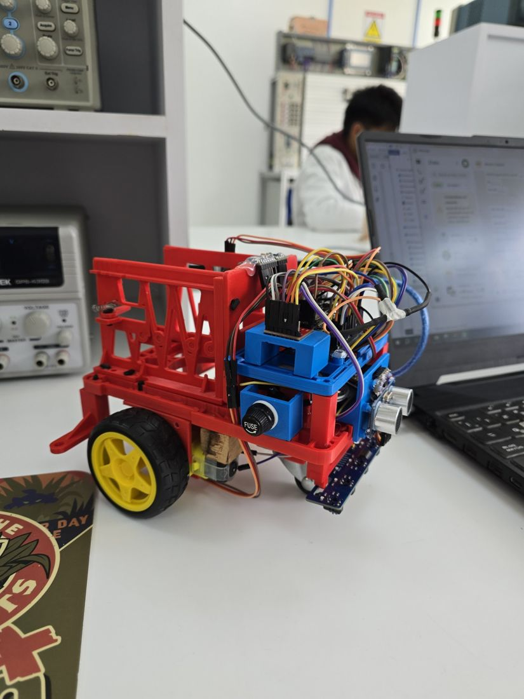 | 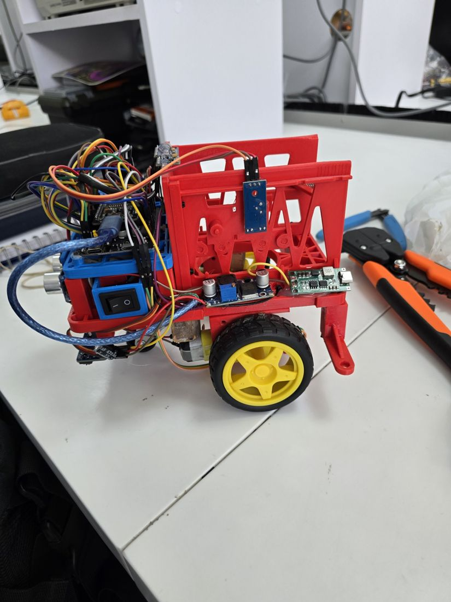 |
| 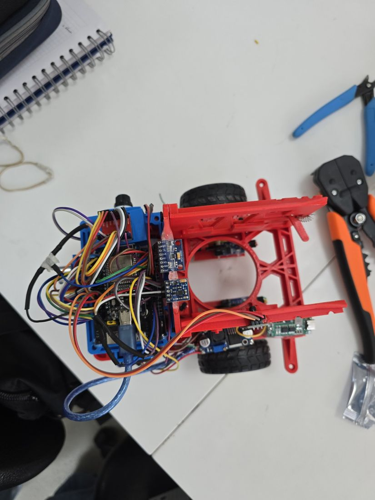 | 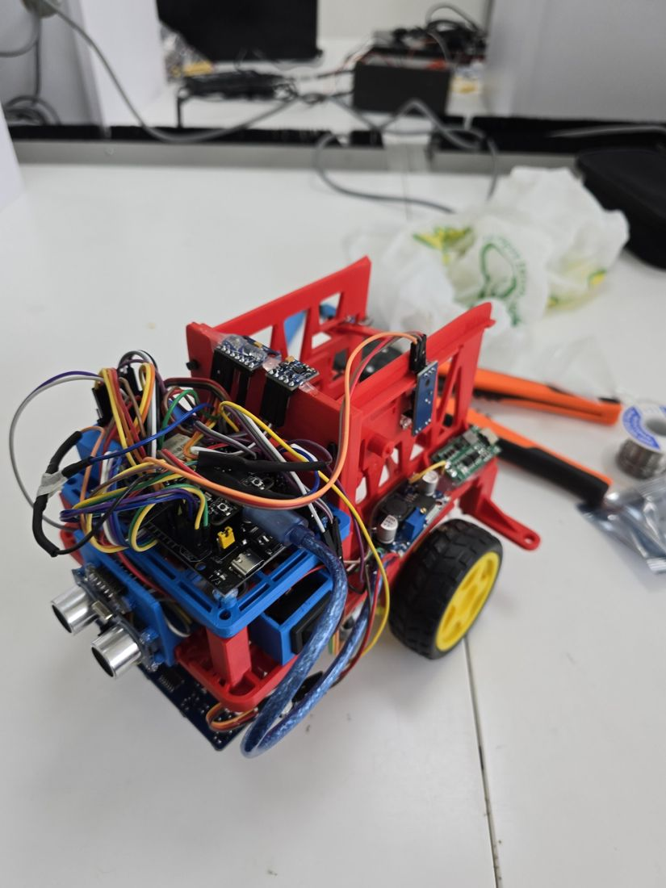 |

De la maqueta de la planta se alcanzaron a imprimir algunas piezas de la estructura y de la canaleta, que se ven en
blanco junto al carro:

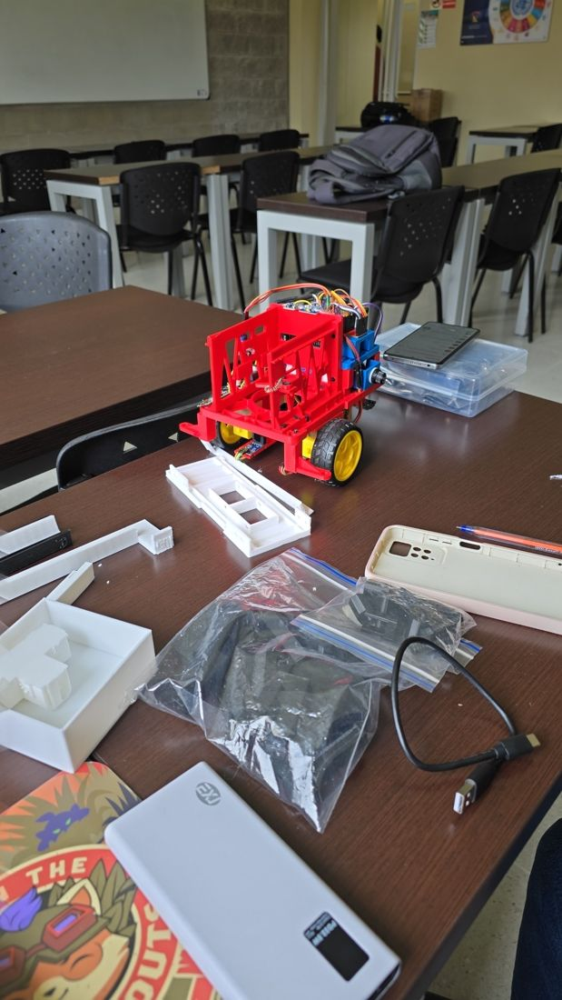

## 3. Por qué solo se entregó una parte

**Falta de tiempo de impresión.** La maqueta completa de la planta, en
[`maqueta_impresa/`](../maqueta_impresa/README.md), pesa 2,98 kg de PLA y necesita unas 101 horas de impresora
repartidas en 26 tandas, con una sola impresora. A eso se suman las 7,7 horas del carro y las reimpresiones. Con el
plazo de la entrega y las demás materias del semestre no alcanzó el tiempo para imprimir todo, y sin la estructura
no se pueden montar las cintas, el almacén ni el embalaje.

**Mala calidad en otras piezas.** Varias de las piezas que sí se imprimieron salieron con defectos que no permitieron
ensamblarlas, y reimprimirlas pedía el mismo tiempo que ya faltaba. Como la maqueta une sus piezas con remaches
impresos que dependen de medidas exactas, una pieza defectuosa no se puede forzar sin romper la unión.

**Qué se priorizó.** Con ese límite se decidió terminar el carro en físico, porque es la parte que se mueve sola y
la que más se beneficia de probarse de verdad, y dejar la planta completa en simulación, con su firmware y su
conexionado listos para cuando se imprima. Por eso la planta se entrega funcionando en PyBullet, donde se puede
demostrar cada filtro por separado, y el carro como la parte física.

## 4. Cómo funciona el sistema

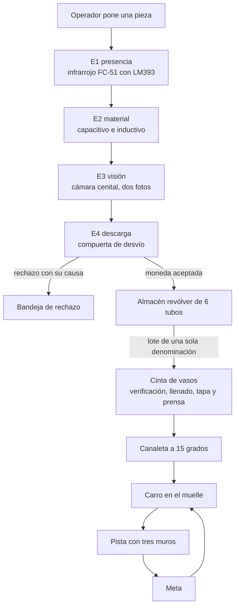

**A nivel mecánico.** La cinta de monedas es negra mate, con separadores que forman casillas de unos 41 mm. Un NEMA 17
la avanza una casilla en 600 ms y la detiene 1000 ms; en esa pausa cada estación lee y decide. El almacén es un
revólver de seis tubos movido por un 28BYJ-48 que pone el tubo correcto debajo del punto de carga, así la moneda cae
casi vertical. Una placa fija con un solo agujero y un obturador suelta el lote al vaso. La prensa es una leva
excéntrica movida por un servo MG996R que asienta la tapa con unos 60 N. El carro tiene dos ruedas motrices y una
rueda loca, para que siempre toque el piso con tres apoyos y su odometría no se pierda.

**A nivel eléctrico.** Una fuente de 12 V y 5 A con un fusible alimenta un convertidor de 6 V solo para los servos,
uno de 5 V para la luz de la cámara y el carrusel, y los 12 V de los drivers y de los sensores capacitivo e inductivo.
El carro va con dos celdas 18650. El detalle está en la [sección 7](#7-conexiones-y-parte-eléctrica).

**A nivel de software.** Toda la lógica vive en Python puro en [`control/`](../control/README.md) y se conecta con la
simulación o con las placas cambiando una sola línea de la configuración. El ESP32 fijo habla con el PC por USB con
líneas JSON numeradas, cada comando espera su confirmación y un comando repetido no se ejecuta dos veces. El carro
recibe órdenes por ESP-NOW. El ciclo de la cinta de monedas es este:

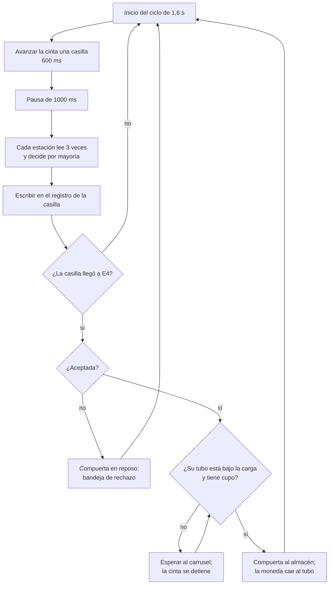

Y el carro, una vez cargado, hace esto:

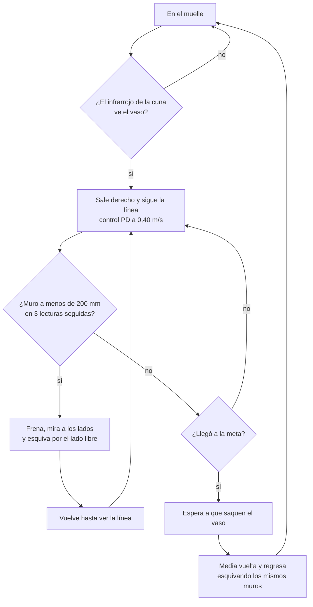

## 5. Avance del módulo de monedas

Este es el avance que se entrega para la actividad del módulo de monedas.

| Qué | Estado | Dónde |
|---|---|---|
| Cinta de cuatro estaciones con su ciclo de tiempos | Diseñada y simulada | [README, recorrido de una moneda](../README.md#el-recorrido-de-una-moneda) |
| Filtro con causa de rechazo y voto de tres lecturas | Programado y probado | [`control/reglas.py`](../control/reglas.py), [lógica interna](logica-interna.md) |
| Tabla de monedas colombianas por generación | Hecha | [`config/monedas.yaml`](../config/monedas.yaml) |
| Almacén revólver con su carrusel y el sensor Hall | Diseñado y simulado | [README, decisiones](../README.md#decisiones-de-diseño-y-por-qué) |
| Firmware del ESP32 fijo | Escrito, probado contra la estación emulada | [`firmware/`](../firmware/README.md) |
| Detector de monedas con YOLO y la cámara del celular | Hecho y probado con fotos reales | [`vision/`](../vision/README.md) |
| Piezas impresas de la cinta y del almacén | Impresas en parte | [`maqueta_impresa/`](../maqueta_impresa/README.md) |
| Montaje y calibración en físico | Pendiente | [replicación](replicacion.md) |

Los sensores del módulo y para qué sirve cada uno:

| Estación | Sensor | Qué decide |
|---|---|---|
| E1 presencia | Infrarrojo FC-51 con comparador LM393 | Si hay una pieza en la casilla |
| E2 material | Capacitivo LJC18A3 e inductivo LJ18A3 | Si la pieza es metálica |
| E3 visión | Cámara cenital con anillo de luz | Diámetro, circularidad, agujeros y cara de la moneda |
| E4 descarga | Servo SG90 de la compuerta | Almacén o bandeja de rechazo |
| Almacén | Sensor Hall A3144 con imán | La posición cero del carrusel al encender |

**El comparador del infrarrojo.** El módulo FC-51 trae un LED infrarrojo, un fototransistor y un comparador LM393. El
voltaje del fototransistor sube cuando recibe más luz reflejada, y el LM393 lo compara con un umbral que se ajusta
con el potenciómetro del módulo. Si la señal pasa el umbral, la salida cambia de estado y el ESP32 recibe un dato
digital limpio en menos de un milisegundo, sin tener que leer ni filtrar una señal analógica. Como la cinta es negra
y casi no refleja, el potenciómetro se ajusta con la cinta vacía hasta que no dispare, y entonces solo dispara cuando
hay una pieza encima.

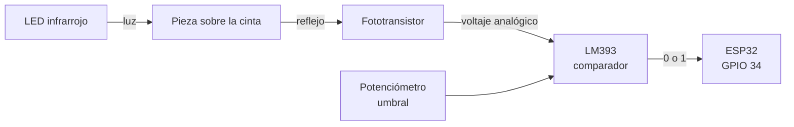

**El capacitivo y el inductivo.** El capacitivo reacciona a cualquier material cerca de su cara porque cambia la
capacitancia de su campo; el inductivo solo reacciona a metal, por las corrientes que su campo induce en la pieza.
Juntos dan algo que ninguno da solo: capacitivo sí e inductivo no es un objeto no metálico, y se rechaza sin gastar
la cámara. Si el inductivo ve metal, es metal aunque el capacitivo falle.

## 6. Lógica para reconocer monedas y su justificación

La decisión se construye acumulando evidencia de estaciones independientes. Cada estación escribe en el registro de
la casilla, el primer filtro que falla fija la causa y ningún filtro posterior puede revertir un rechazo.

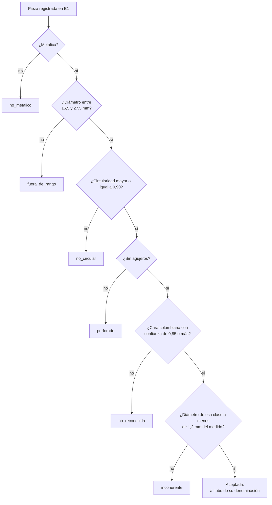

**Por qué en ese orden.** Los filtros baratos van primero: el material descarta plásticos y bloques sin usar la cámara.
Después la geometría descarta lo que no tiene tamaño ni forma de moneda, como arandelas y botones con ojales. Y al
final va la cara, que es la única que distingue una moneda colombiana de una extranjera del mismo tamaño.

**Por qué el tamaño no basta.** Lo probamos con monedas reales:

| | |
|---|---|
| 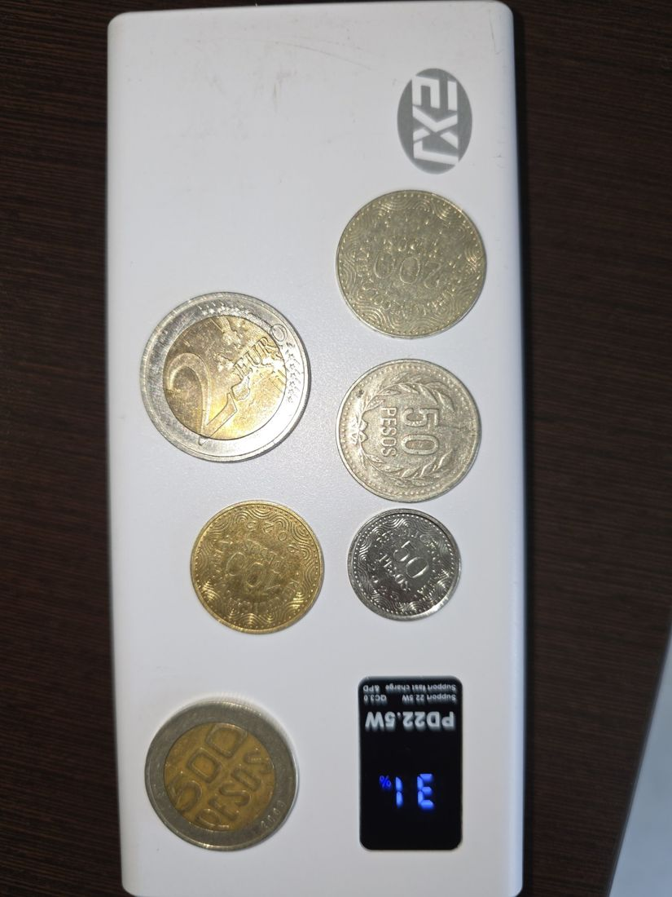 | 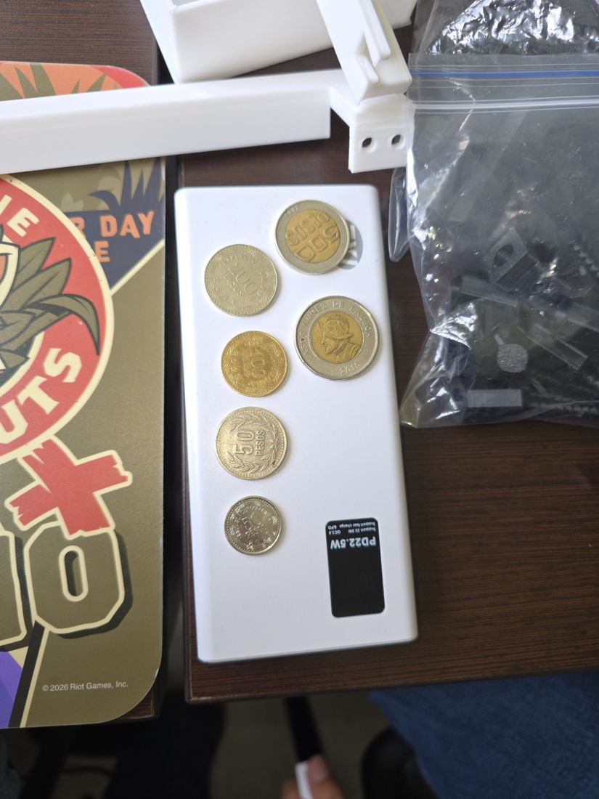 |

| Moneda | Diámetro, mm | Bimetálica | Qué debe pasar |
|---|---:|---|---|
| $1000 nueva | 26,7 | sí | Aceptada |
| 1 balboa de Panamá | 26,5 | sí | no_reconocida |
| 2 euros | 25,75 | sí | no_reconocida |
| $500 nueva | 23,7 | sí | Aceptada |
| 1 euro | 23,25 | sí | no_reconocida |

La de 1 balboa mide 0,2 mm menos que la de $1000 y también es bimetálica: ningún filtro de tamaño ni de color las
separa. Por eso la clase la decide la cara reconocida por la cámara, y después la **regla de coherencia** exige que
el diámetro nominal de esa clase coincida con el medido a menos de 1,2 mm. Si la cámara confunde una moneda extranjera
con una colombiana pero su tamaño no cuadra, se rechaza; y si una pieza tiene el tamaño correcto pero la cara no se
reconoce con confianza, tampoco entra. El sistema garantiza rechazar lo que no reconoce, no reconocer cualquier
moneda del mundo.

**Por qué leer tres veces y tomar dos fotos.** Un sensor real se equivoca. En la simulación cada sensor tiene su
probabilidad de error, y con eso medimos: leer una sola vez rechazó por error 13 monedas colombianas de 520; leer
tres veces y decidir por mayoría bajó a 5. Con las fotos, exigir que las dos coincidieran rechazaba 39 monedas buenas
de 720; la regla que quedó, aceptar la clase si las fotos que reconocen dicen lo mismo, dejó 7 y ninguna moneda en
el vaso equivocado.

**El detector con YOLO.** Como avance de la visión real, el detector de [`vision/`](../vision/README.md) encuentra
y clasifica monedas en fotos tomadas con el celular. Une dos modelos de segmentación, yolo11n y yolov8n, con un
clasificador de recortes, y además busca la escala en píxeles por milímetro que hace cuadrar los diámetros de todas
las monedas de la foto con la tabla, la misma idea de la regla de coherencia. En las fotos de prueba acertó la clase
en 27 de 33 monedas, y descarta lo que no es redondo o tiene agujeros.

## 7. Conexiones y parte eléctrica

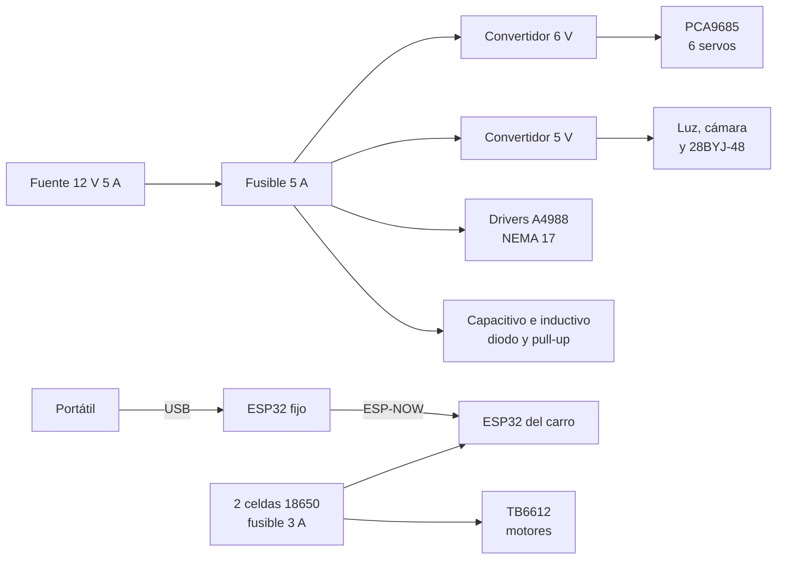

| Placa | Función | GPIO |
|---|---|---|
| Fijo | I2C corto, PCA9685 de los 6 servos | SDA 21, SCL 22 |
| Fijo | I2C largo, VL53L0X del vaso y de la cortina | SDA 16, SCL 17, XSHUT 18 y 19 |
| Fijo | NEMA 17 de monedas, STEP y DIR | 25 y 26 |
| Fijo | NEMA 17 de vasos, STEP y DIR, ENABLE común | 27 y 14, 13 |
| Fijo | Carrusel 28BYJ-48 por ULN2003 | 32, 33, 23 y 4 |
| Fijo | Presencia, capacitivo, inductivo y Hall | 34, 35, 36 y 39 |
| Carro | TB6612, PWMA, AIN1 y AIN2 | 25, 26 y 27 |
| Carro | TB6612, PWMB, BIN1, BIN2 y STBY | 33, 32, 13 y 4 |
| Carro | Encoders | 18 y 19 |
| Carro | Cinco infrarrojos de línea | 34, 35, 36, 39 y 16 |
| Carro | HC-SR04, TRIG y ECHO por divisor | 17 y 23 |
| Carro | VL53L0X frontal e infrarrojo de la cuna | 21 y 22, 14 |

No se usan los pines de arranque 0, 2, 5, 12 y 15 ni los de la memoria, del 6 al 11. Los pines 34 a 39 son solo de
entrada, por eso van ahí los sensores.

**Protección de los pines.** El ESP32 trabaja a 3,3 V, así que nada de más voltaje puede llegar a un pin:

- El eco del HC-SR04 sale a 5 V y baja con un divisor de 1 kΩ y 2 kΩ: 5 V × 2 / 3 = 3,33 V.
- El capacitivo y el inductivo son de salida NPN a 12 V. Un diodo Schottky BAT85 bloquea los 12 V y una pull-up de
  10 kΩ a 3,3 V da el nivel alto; al detectar, el pin queda en unos 0,57 V, debajo de los 0,825 V que el ESP32 lee
  como cero.
- El I2C largo de los dos VL53L0X va a 100 kHz con pull-ups de 2,2 kΩ, porque con 1,7 m de cable la señal no sube a
  tiempo a 400 kHz.

Una simulación eléctrica de un ciclo completo dio picos de 2,93 A en el riel de 12 V y 3,47 A en el de los servos,
dentro de los 5 A de cada uno, porque el firmware no deja que la prensa y el empujador arranquen a la vez. El
conexionado hilo por hilo está en [`conexiones.md`](conexiones.md), la parte eléctrica en [`electrica.md`](electrica.md)
y el porqué de cada componente en [`justificacion-componentes.md`](justificacion-componentes.md).

## 8. La importancia del ESP32

El ESP32 es lo que hace posible el sistema con dos placas baratas. En un solo chip trae dos núcleos a 240 MHz, Wi-Fi,
Bluetooth, ESP-NOW, ADC de 12 bits, temporizadores, PWM e I2C, así que:

- **Una sola placa maneja la estación**: dos motores paso a paso, el carrusel, seis servos por I2C y seis sensores, y
  además hace de puente de radio con el carro.
- **La seguridad vive en la placa**, no en el PC: si no oye el latido del PC en 2 s, detiene las cintas, sube la
  prensa y deja la compuerta apuntando al rechazo. La cortina también la atiende la placa sin esperar al PC.
- **ESP-NOW une la estación con el carro** sin router, así no dependemos de la red del salón.
- **El carro corre su propio control** a 50 Hz con MicroPython, y es el mismo código que se probó en la simulación.

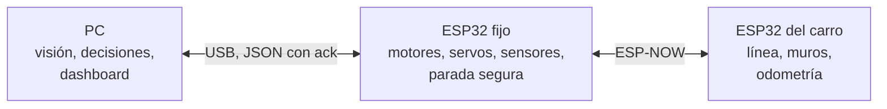

## 9. Lo que entendimos

- **Un sensor real se equivoca**, así que el diseño tiene que asumirlo: leer varias veces y cruzar sensores
  independientes da más confianza que buscar un sensor perfecto.
- **El comparador LM393** convierte una señal analógica ruidosa en un dato digital, y su umbral se ajusta en el sitio,
  con la cinta real y la luz real.
- **Los voltajes importan**: un sensor de 12 V o un eco de 5 V queman un pin de 3,3 V si no se protegen con un diodo o
  un divisor.
- **Separar la lógica del hardware** nos dejó probar todo en simulación antes de tener las piezas, y el mismo código
  corre en la placa.
- **El tamaño no identifica una moneda**: hace falta la cara, y cruzarla con el tamaño.
- **En un proyecto con impresión 3D, el tiempo de fabricación es parte del diseño.** Una maqueta de 101 horas hay que
  planearla desde el principio, imprimir primero piezas de prueba para ajustar el perfil y dejar margen para
  reimprimir las que fallan. Fue lo que más nos costó.

## 10. Lo que falta y cómo seguir

1. Reimprimir las piezas defectuosas con el perfil ajustado y terminar las tandas de la maqueta.
2. Armar las cintas, el almacén y el embalaje, y cablearlos según la [sección 7](#7-conexiones-y-parte-eléctrica).
3. Subir el firmware a las placas y probar la comunicación con el puente serial.
4. Medir los valores provisionales y hacer la prueba de banco de 200 pasadas de cada sensor, como dice
   [`replicacion.md`](replicacion.md).
5. Conectar la visión real a la línea en lugar del modo oráculo de la simulación.

Cómo correr la simulación y la app del proyecto: [README, cómo probarlo](../README.md#paso-a-paso).
