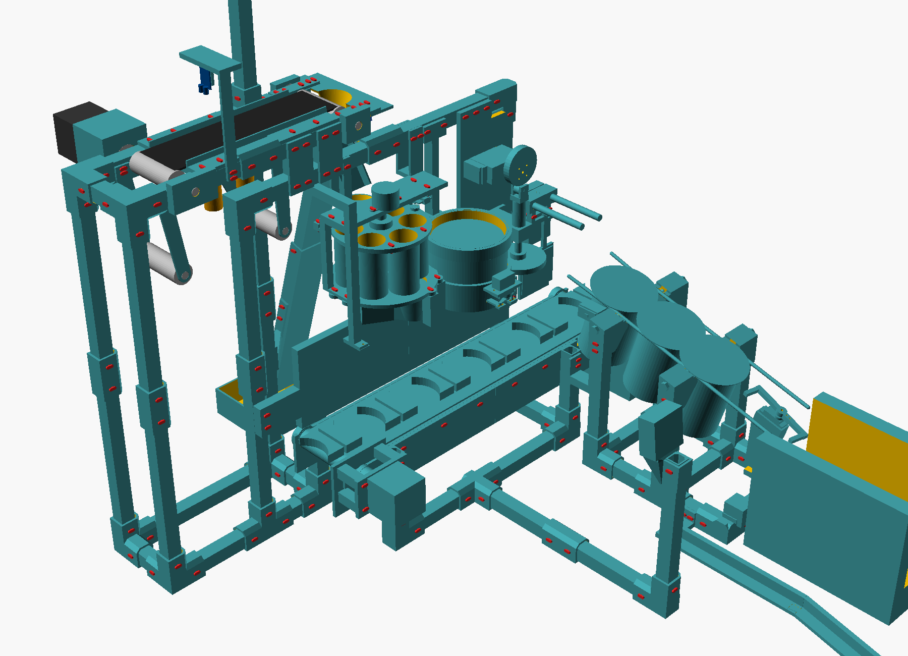

# Maqueta impresa

Toda la maqueta de la planta (mesas, pórtico, soportes, almacén de monedas, mecanismos y canaleta) en PLA, para la
Creality Hi. Reemplaza los 6,1 m de perfil de aluminio 2020, las 24 escuadras, los 15 pies niveladores, las placas
de aluminio y las piezas de acrílico (los tubos y discos del almacén y el tubo de tapas también son impresos).
Lo comprado sigue siendo comprado: motores, servos, sensores, cámaras, bandas, rodillos, ejes y rodamientos.



## Números

| | |
|---|---|
| Piezas impresas | 170 (más 369 remaches de 9 medidas) |
| PLA | **2,68 kg**: 3 rollos de 1 kg con el 10 % de desperdicio (≈ $277.000). Aligerada el 2026-10-24 (vaciados, nervios y paredes de 1,6 donde no carga; ~235 g menos de geometría) manteniendo la rigidez |
| Tiempo de impresora | ≈ 81 h (±30 %; el real lo da Creality Print), en 25 tandas de una cama cada una |
| Uniones | 310 remaches impresos, cada uno con su agarre **medido en el ensamble** |

El detalle por pieza y por tanda está en [material.md](material.md); el armado, paso a paso, en
[manual_maqueta.pdf](manual_maqueta.pdf).

## Cómo está hecha

- **Estructura** (`estructura.py` → `estructura_gen.scad`): tubos de 16 × 16 impresos acostados (hueco con
  chaflanes de 45°: sale sin soportes), nodos con cajeras donde entra el tubo entero 22 mm, empalmes para los tramos
  de más de 240 mm y tacos entre la mesa de monedas y la viga. Un piso de tubos amarra todo en una sola pieza. Nada
  pasa bajo la banda de vasos (la vuelta de abajo con sus separadores baja a z 81).
- **Subsistemas**, un archivo cada uno: `almacen.scad`, `cinta_monedas.scad`, `cinta_vasos.scad`,
  `tapas_prensa_empujador.scad`, `canaleta_muelle.scad`. Las reglas comunes están en [CONVENCIONES.md](CONVENCIONES.md).
- `maqueta.scad` junta todo, en el mismo marco de `sim/mundo.py` pero en mm.

## Cómo se revisó (la lección del carro)

En el carro, el remache del porta baterías no pasaba y dos de los rodillos no agarraban nada: su agarre se había
sacado de fórmulas. Aquí `revisar.py` **mide** todo en el ensamble:

- cada remache, con rayos por su eje: que junte exactamente su agarre (±0,3 mm), que detrás quede hueco para que
  abra la uña, que el agujero esté libre, que la cabeza no choque y que haya espacio para meterlo con el dedo;
- choques entre todas las piezas y con lo comprado;
- **lo que se mueve** (carrusel, obturador, aleta E4, bandas con sus separadores, dedos, leva, prensa, empujador,
  escape, vaso bajando por la canaleta) barrido en todo su recorrido, contra todo lo fijo y contra los otros barridos;
- que cada pieza salga sin soportes y quepa en la cama.

Y `probar_revisor.py` le mete 39 errores a propósito (y casos buenos) para comprobar que el revisor los atrapa: 39
de 39. La última revisión completa: 310 remaches, 170 piezas, 13 partes móviles y 74 pares de barridos, **TODO OK**.

## Cómo regenerar

```
python estructura.py      # estructura_gen.scad y estructura_resumen.md (con sus propias comprobaciones)
python revisar.py         # todo (≈ 6 min); con --sub alm solo un subsistema
python probar_revisor.py  # el revisor contra errores puestos a propósito
python exportar.py        # stl/, 3mf/, piezas.json y material.md
python esfuerzos.py       # esfuerzos.md: flexión, pandeo, remaches, cajeras y calor
python manual_maqueta.py  # manual_maqueta.pdf
```

## Lo que cambió respecto del diseño anterior (manda lo físico)

Lo funcional no se movió (estaciones, alturas de bandas, carrusel, tolva, canaleta, sensores, cámaras). Sí cambió:

- La viga del pórtico pasó de y −45 a y −40,5 (alineada con el riel de la mesa de monedas); patas, columnas y
  postes en otras posiciones; ya no hay poste E4 (la compuerta cuelga de los bloques del tensor).
- Salida del embudo E4 de Ø20 a **Ø29**: por Ø20 no pasaba acostada la moneda de 26,7 mm. Aleta nueva de 20 mm.
- Obturador del almacén que gira en horizontal (al bajar chocaba con la tolva); 28BYJ-48 girado 90° (una pestaña
  quedaba sobre la boca del embudo); embudo de carga que termina en z 335 (el imán lo golpeaba).
- Paleta del empujador de 56 mm con la esquina de abajo cortada (rozaba los tacos de la banda al dar la vuelta).
- Separadores de la banda de vasos recortados 3 mm y una muesca en el bastidor: el vaso recién entregado a la
  canaleta tocaba el borde.
- El vaso retenido por el escape queda ~17 mm más abajo que lo que dibujaba el visor.

## Esfuerzo, deformación y calor

`esfuerzos.py` → [esfuerzos.md](esfuerzos.md): cada tubo cargado (flexión y flecha), cada columna (pandeo), cada
unión de remaches (cortante y arranque de la uña), el aplastamiento en las cajeras y cada fuente de calor que toca
PLA, contra el PLA impreso (admisible 10 MPa en cargas cortas, 5 MPa sostenidas por fluencia, nada que cargue por
encima de 45 °C). Todo cumple; lo más exigido es la viga del pórtico cuando la prensa asienta una tapa (4,7 MPa de
10, 1,6 mm de flecha momentánea). Dos condiciones salen de ahí y están en el manual: el NEMA 17 **no apoya directo**
en su placa (separadores de nailon: a 1 A/fase llega a 46 °C en una prueba continua) y la tira LED del panel va
sobre cinta de aluminio y a media potencia. Son modelos simples del lado seguro, no elementos finitos.

## Lo que no está verificado

- Los remaches y los encajes se prueban al imprimir; los esfuerzos son calculados, no ensayados. Hay que medir la
  carcasa del NEMA 17 en la prueba de banco.
- La rosca impresa de los prisioneros de la canaleta y la cola de milano de las bocas del muelle.
- Las medidas marcadas `MEDIR` en cada `.scad` (servos, sensores, webcam): medirlas antes de imprimir esas piezas.
- La caja de control no es parte de esta carpeta (su cableado sí está en el manual).
